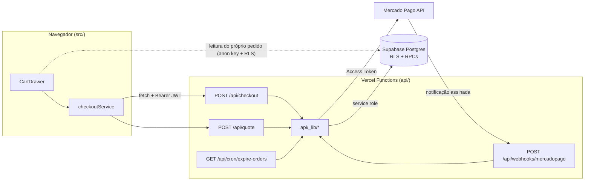
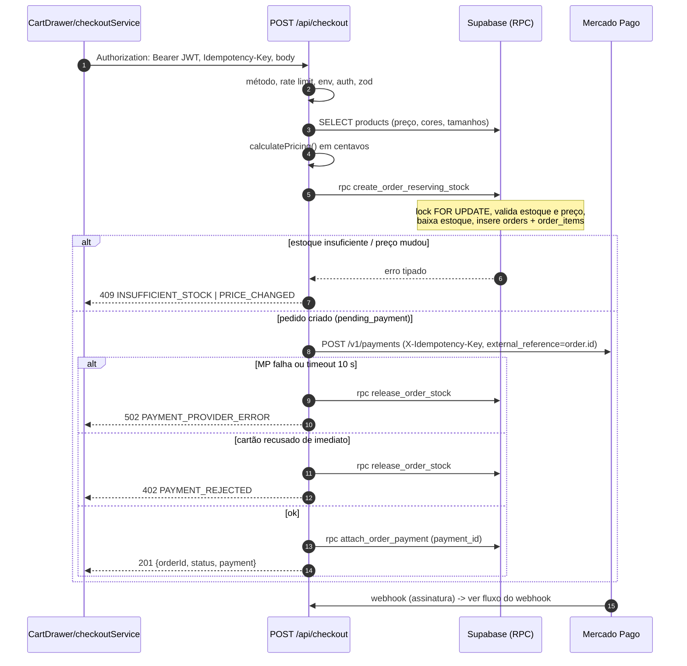
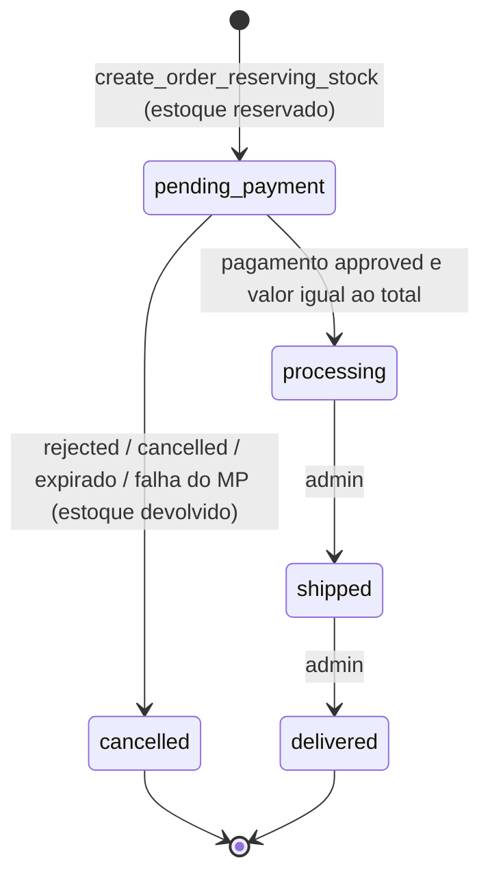
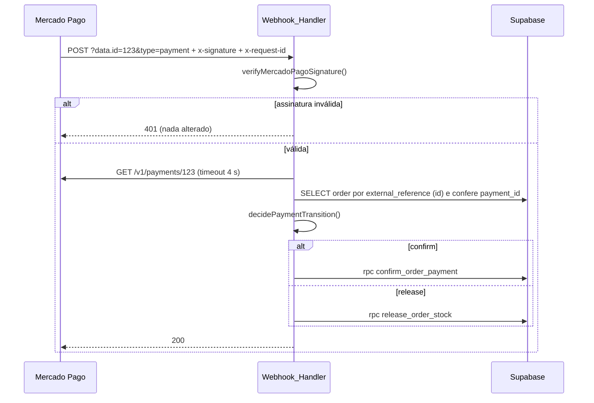

# Design Document: backend-architecture

## Overview

Este design implementa o MVP de checkout seguro da Loja Vitta com Vercel Functions em TypeScript na pasta `/api`, no mesmo repositório e no mesmo deploy do front-end (Vite + React). O servidor passa a ser a única fonte de verdade para preço, frete, cupom, estoque e total. O cliente envia apenas identificadores, quantidades, cupom, forma de pagamento e endereço.

Problemas do código atual que o design corrige:

| Fato no código | Consequência | Correção |
| :--- | :--- | :--- |
| `CartDrawer.handleCheckout` envia `price`, `productName` e `totalAmount` para `tomatoApi.createOrder`, que grava direto em `orders`/`order_items`. | Cliente adulterado define o preço pago. | Rota `POST /api/checkout` recalcula tudo; RLS bloqueia INSERT do cliente. |
| `CartContext.total = subtotal` (sem frete), enquanto o `CartDrawer` exibe "Frete R$ 50" ou "GRÁTIS" sem somá-lo ao total. | O total exibido e o total gravado não incluem frete. | O servidor calcula `total = subtotal - desconto + frete`. O contexto passa a exibir a mesma fórmula como estimativa. |
| `CartContext` e `tomatoApi` não têm lógica de cupom. `PRIMEIRACOMPRA` e `VITTA10` só aparecem em `ARCHITECTURE.md`. | Regras e valores de desconto não existem. | Módulo `api/_lib/config/coupons.ts` com valores **A CONFIRMAR PELO DONO DA LOJA**. |
| `orders.status` nasce como `pending` no schema, mas `createOrder` grava `processing` na criação. | Pedido aparece como em processamento antes de qualquer pagamento. | Máquina de estados com `pending_payment` e transição por webhook. |
| `products.id` e `order_items.product_id` são UUID. `products.stockCount` e `products.inStock` guardam o estoque (não há `inventory_items` no banco). | Estoque é por produto, não por variante. | Baixa atômica por RPC sobre `products`. O estoque por cor/tamanho fica fora do MVP. |

### Decisões principais

1. **Estoque: reservar na criação do pedido** (e devolver em cancelamento ou expiração), em vez de debitar só após o pagamento. Justificativa e expiração na seção "Reserva de estoque".
2. **Criação do pedido, validação de estoque e baixa em uma única função SQL transacional** (`create_order_reserving_stock`). Isso resolve a concorrência (requisito 5.3) com `SELECT ... FOR UPDATE` e evita estado parcial.
3. **Valores em centavos inteiros** em todo o código do servidor. Conversão para `DECIMAL(10,2)` só na fronteira com o banco e com o Mercado Pago.
4. **Mercado Pago via `fetch` direto** (sem SDK), com timeout de 10 s. Menos dependências e controle total de cabeçalhos de idempotência.
5. **Rota extra `POST /api/quote`** (adição ao escopo dos requisitos, pequena): reutiliza o Pricing_Engine sem efeitos colaterais. Sem ela, o cliente que paga com cartão só veria o desconto depois de já ter sido cobrado. O parent deve confirmar se mantém.

## Architecture

### Visão geral



### Estrutura da pasta `/api`

Na Vercel, cada arquivo de `/api` vira uma rota. Arquivos e pastas com prefixo `_` não viram rota, então todo código compartilhado fica em `api/_lib/`.

```
api/
  tsconfig.json                    # lib ES2023, types node, moduleResolution bundler, strict
  checkout.ts                      # POST /api/checkout
  quote.ts                         # POST /api/quote
  webhooks/
    mercadopago.ts                 # POST /api/webhooks/mercadopago
  cron/
    expire-orders.ts               # GET  /api/cron/expire-orders  (protegido por CRON_SECRET)
  _lib/
    env.ts                         # leitura/validação lazy das variáveis (zod)
    http.ts                        # route(): CORS, método, try/catch, formato de erro, requestId
    errors.ts                      # AppError + catálogo de códigos
    logger.ts                      # log JSON com redação de segredos
    auth.ts                        # Bearer -> usuário (supabase.auth.getUser)
    supabase.ts                    # createAdminClient(env)
    rateLimit.ts                   # janela deslizante em memória
    schemas.ts                     # zod: checkout, quote, webhook query
    config/
      shipping.ts                  # FREE_SHIPPING_THRESHOLD_CENTS, SHIPPING_FEE_CENTS
      coupons.ts                   # COUPON_RULES (A CONFIRMAR)
    pricing/
      engine.ts                    # função pura calculatePricing()
    stock/
      stockService.ts              # reserveAndCreateOrder(), releaseOrderStock()
    orders/
      orderService.ts              # createCheckout(), replay/resume, attachPayment
      stateMachine.ts              # decidePaymentTransition() pura
      expire.ts                    # expireStaleOrders()
    payments/
      mercadoPago.ts               # createPixPayment, createCardPayment, getPayment, cancelPayment
      webhookSignature.ts          # verifyMercadoPagoSignature() pura
  _tests/                          # Vitest (ambiente node)
```

### Respeito a `architecture.contract.json`

O contrato atual não conhece `api/`. Mudanças propostas no contrato:

```json
{
  "name": "api",
  "path": "api/**",
  "allowedDependencies": ["types"]
}
```

- A camada `api` só pode importar de `types`, e apenas com `import type` (garantido por teste, ver Estratégia de Testes). Nenhuma importação de `src/services`, `src/context` ou `src/components`.
- Nenhuma camada de `src/` importa de `api/`. O front-end se comunica com o servidor somente por HTTP.
- Contratos de request/response ficam em `src/types/checkout.ts` (interfaces e uniões de string, sem imports), compartilhados por `api` e `services`. Os esquemas zod ficam em `api/_lib/schemas.ts` e são ligados aos tipos com `satisfies z.ZodType<CheckoutRequest>`, de modo que o compilador acusa divergência. `zod` não entra no bundle do navegador.
- Observação: `tomatoApi.ts` já importa `../config/supabase`, e o contrato não declara camada `config`. O design recomenda adicionar `{ "name": "config", "path": "src/config/**", "allowedDependencies": [] }` e permitir `config` em `services`, o que formaliza o que `ARCHITECTURE.md` já descreve. Esta mudança é opcional e não bloqueia o MVP.
- `src/types/ecommerce.ts`: `Order.status` ganha `'pending_payment'`. `checkoutService` entra em `src/services` (camada permitida a depender de `types`).

### Configuração da Vercel (`vercel.json`)

- O rewrite `/(.*) -> /index.html` passa a `/((?!api/).*)`, para que o SPA nunca capture rotas `/api`.
- `functions`: `api/checkout.ts` com `maxDuration` 20 (o timeout do Mercado Pago é 10 s). `api/webhooks/mercadopago.ts` com `maxDuration` 10.
- `crons`: `/api/cron/expire-orders` a cada 10 minutos. No plano Hobby, a Vercel limita crons a execução diária; nesse caso, a expiração preguiçosa descrita abaixo cobre o intervalo.
- CSP: a Brick do Mercado Pago (cartão) exige `script-src https://sdk.mercadopago.com`, `connect-src https://api.mercadopago.com https://*.mercadolibre.com` e `frame-src https://*.mercadopago.com`. A lista exata deve ser conferida na documentação do Mercado Pago na implementação.

## Components and Interfaces

### Fluxo de checkout



Ordem dos passos do handler (`api/checkout.ts`): `route()` valida método e CORS, aplica rate limit, carrega o ambiente, autentica, valida o corpo com zod, lê os produtos, calcula o preço, executa a RPC, cria a cobrança e responde. Qualquer erro vira `AppError` com código estável.

### `api/_lib/http.ts`

```ts
export interface RouteOptions {
  methods: ReadonlyArray<'GET' | 'POST'>;
  rateLimit?: { key: 'user' | 'ip'; max: number; windowMs: number };
  handler: (ctx: RouteContext) => Promise<RouteResult>;
}
export interface RouteContext {
  req: VercelRequest;
  env: ServerEnv;       // validado; lança SERVER_MISCONFIGURED se faltar algo
  requestId: string;
  log: Logger;
}
export interface RouteResult { status: number; body: unknown; headers?: Record<string, string> }
export function route(opts: RouteOptions): (req: VercelRequest, res: VercelResponse) => Promise<void>;
```

Comportamento de `route()`:

- `OPTIONS`: responde 204 com os cabeçalhos CORS, sem exigir autenticação.
- Método fora de `methods`: 405 `METHOD_NOT_ALLOWED` com cabeçalho `Allow`.
- **CORS**: `Access-Control-Allow-Origin` só é emitido quando `req.headers.origin === env.SITE_URL`. Com origem diferente, a resposta não leva o cabeçalho (o navegador bloqueia). Cabeçalhos permitidos: `Authorization, Content-Type, Idempotency-Key`. `Vary: Origin` sempre. O webhook e o cron não são chamados por navegador e não emitem CORS.
- Erros: `AppError` vira `{ error: { code, message, details? } }` com o status do catálogo. Qualquer outro erro vira `500 INTERNAL_ERROR` com mensagem genérica, e o erro real vai somente para o log (já redigido).
- Resposta sempre inclui `X-Request-Id`.

### Rate limiting simples

`rateLimit.ts` implementa janela deslizante em `Map<string, number[]>` em memória, com limpeza oportunista. Limites do MVP: `/api/checkout` 10 req/min por usuário, `/api/quote` 30 req/min por usuário, e 60 req/min por IP antes da autenticação (IP vem de `x-forwarded-for`, primeiro valor). Excesso: 429 `RATE_LIMITED` com `Retry-After`.

Limitação assumida: o estado é por instância da função e some em cold start, então é uma barreira contra abuso casual, não contra ataque distribuído. A defesa que importa para estoque é outra: a RPC recusa o pedido quando o usuário já tem 3 pedidos em `pending_payment` (`TOO_MANY_PENDING_ORDERS`, 429), porque a reserva de estoque pode ser usada para esvaziar a vitrine. Para limite global robusto, a evolução é Upstash/Vercel KV, fora do MVP.

### Contratos das rotas

Tipos em `src/types/checkout.ts`:

```ts
export type PaymentMethod = 'pix' | 'card';

export interface CheckoutItemInput {
  productId: string;          // UUID de products.id
  color: string;              // nome da cor, deve existir em products.colors
  size: string;               // deve existir em products.sizes
  quantity: number;           // inteiro 1..99
}

export interface CardPaymentInput {
  token: string;              // token gerado pelo SDK do Mercado Pago no navegador
  paymentMethodId: string;    // ex.: 'visa'
  installments: number;       // 1..12
  issuerId?: string;
}

export interface CheckoutRequest {
  items: CheckoutItemInput[]; // 1..50 itens
  couponCode?: string;        // até 32 caracteres
  paymentMethod: PaymentMethod;
  shippingAddress: string;    // 1..300 caracteres após trim
  card?: CardPaymentInput;    // obrigatório quando paymentMethod === 'card'
}

export interface PricingBreakdown {  // valores em centavos inteiros
  subtotalCents: number;
  discountCents: number;
  shippingCents: number;
  totalCents: number;
  couponCode: string | null;   // código normalizado, ou null
}

export interface PixPaymentData {
  kind: 'pix';
  qrCode: string;              // copia-e-cola
  qrCodeBase64: string;        // imagem PNG em base64
  expiresAt: string;           // ISO 8601
}
export interface CardPaymentData {
  kind: 'card';
  status: 'approved' | 'in_process';
  last4?: string;
}

export interface CheckoutResponse {
  orderId: string;
  status: 'pending_payment' | 'processing';
  pricing: PricingBreakdown;
  payment: PixPaymentData | CardPaymentData;
  replayed: boolean;           // true quando a Idempotency-Key já havia sido usada
}

export type QuoteRequest = Pick<CheckoutRequest, 'items' | 'couponCode'>;
export interface QuoteResponse { pricing: PricingBreakdown }

export type CheckoutErrorCode =
  | 'VALIDATION_ERROR' | 'UNAUTHENTICATED' | 'METHOD_NOT_ALLOWED'
  | 'PRODUCT_NOT_FOUND' | 'INVALID_VARIANT' | 'INVALID_COUPON' | 'COUPON_NOT_ELIGIBLE'
  | 'IDEMPOTENCY_KEY_REUSED' | 'INSUFFICIENT_STOCK' | 'PRICE_CHANGED'
  | 'PAYMENT_REJECTED' | 'PAYMENT_PROVIDER_ERROR'
  | 'RATE_LIMITED' | 'TOO_MANY_PENDING_ORDERS'
  | 'SERVER_MISCONFIGURED' | 'INTERNAL_ERROR';

export interface ApiErrorBody {
  error: { code: CheckoutErrorCode; message: string; details?: unknown };
}
```

Esquema zod (`api/_lib/schemas.ts`), resumido:

```ts
const itemSchema = z.object({
  productId: z.string().uuid(),
  color: z.string().min(1).max(60),
  size: z.string().min(1).max(20),
  quantity: z.number().int().min(1).max(99),
}).strict();

export const checkoutSchema = z.object({
  items: z.array(itemSchema).min(1).max(50),
  couponCode: z.string().trim().max(32).optional(),
  paymentMethod: z.enum(['pix', 'card']),
  shippingAddress: z.string().trim().min(1).max(300),
  card: z.object({
    token: z.string().min(1).max(200),
    paymentMethodId: z.string().min(1).max(40),
    installments: z.number().int().min(1).max(12),
    issuerId: z.string().max(20).optional(),
  }).strict().optional(),
}).strip()   // campos desconhecidos (price, total, shipping, cardNumber...) são descartados
  .refine(v => v.paymentMethod !== 'card' || v.card !== undefined, { path: ['card'] });
```

`.strip()` no objeto raiz garante o requisito 1.6 (preço, frete, desconto e total enviados pelo cliente são ignorados) e o 6.7 (campos como número, validade ou CVV nunca chegam à camada de pagamento). `itemSchema` é `.strict()` de propósito: um item com `price` é erro de validação e não é silenciosamente aceito. O corpo enviado ao Mercado Pago é montado campo a campo (lista branca), nunca por *spread* da entrada.

| Rota | Método | Sucesso | Erros |
| :--- | :--- | :--- | :--- |
| `/api/checkout` | POST | 201 `CheckoutResponse` (200 em repetição idempotente) | 400, 401, 402, 405, 409, 422, 429, 500, 502 |
| `/api/quote` | POST | 200 `QuoteResponse` | 400, 401, 405, 409 (`INSUFFICIENT_STOCK` não se aplica; só 422/400/401/429/500) |
| `/api/webhooks/mercadopago` | POST | 200 `{ received: true }` | 401 assinatura inválida, 500 falha interna (o Mercado Pago repete) |
| `/api/cron/expire-orders` | GET | 200 `{ expired, confirmed }` | 401 sem `CRON_SECRET` |

Cabeçalho obrigatório em `/api/checkout`: `Idempotency-Key` (UUID v4 gerado pelo cliente). A ausência ou formato inválido gera 400 `VALIDATION_ERROR`.

### Catálogo de erros e códigos HTTP

| Código | HTTP | Quando |
| :--- | :--- | :--- |
| `VALIDATION_ERROR` | 400 | Corpo, cabeçalho ou query fora do esquema. `details`: lista `{ path, message }` |
| `UNAUTHENTICATED` | 401 | Token ausente, malformado, expirado ou inválido |
| `METHOD_NOT_ALLOWED` | 405 | Método diferente do permitido |
| `PAYMENT_REJECTED` | 402 | Cartão recusado na resposta síncrona do Mercado Pago |
| `PRODUCT_NOT_FOUND` | 422 | `productId` inexistente. `details.productIds` |
| `INVALID_VARIANT` | 422 | Cor ou tamanho fora das listas do produto |
| `INVALID_COUPON` | 422 | Cupom desconhecido **ou ainda não confirmado pelo dono** |
| `COUPON_NOT_ELIGIBLE` | 422 | `PRIMEIRACOMPRA` e usuário já tem pedido não cancelado |
| `IDEMPOTENCY_KEY_REUSED` | 422 | Mesma chave com corpo diferente (hash do pedido diverge) |
| `INSUFFICIENT_STOCK` | 409 | Estoque menor que o pedido. `details.products: [{ productId, requested, available }]` |
| `PRICE_CHANGED` | 409 | Preço mudou entre a leitura e a reserva. O cliente deve recalcular |
| `RATE_LIMITED` | 429 | Limite de requisições |
| `TOO_MANY_PENDING_ORDERS` | 429 | 3 ou mais pedidos em `pending_payment` do usuário |
| `PAYMENT_PROVIDER_ERROR` | 502 | Mercado Pago rejeitou a criação, falhou ou excedeu 10 s |
| `SERVER_MISCONFIGURED` | 500 | Variável de ambiente obrigatória ausente (sem expor o nome) |
| `INTERNAL_ERROR` | 500 | Qualquer outra falha. Mensagem genérica, sem stack nem erro do banco |

Diferença deliberada em relação ao requisito 6.6: cartão recusado pelo emissor volta com HTTP 201 do Mercado Pago e `status: rejected`. Isso não é falha do provedor, então o design responde 402 `PAYMENT_REJECTED` (e também libera o estoque e cancela o pedido). O 502 fica para erro, rejeição da requisição ou timeout da API.

### Autenticação

`auth.ts` extrai `Bearer <jwt>` e chama `adminClient.auth.getUser(jwt)`. Isso valida assinatura e expiração no Supabase. O nome e o e-mail do cliente vêm do usuário autenticado (`user.email`, `user.user_metadata.name`), e não do corpo. O `CartDrawer` deixa de enviar `customerName` e `customerEmail` (hoje há o fallback `cliente.vip@vittabasics.com`).

### Pricing_Engine (`pricing/engine.ts`)

Função pura, sem I/O. O handler lê os produtos antes e passa o catálogo como argumento.

```ts
export interface CatalogProduct {
  id: string; name: string; priceCents: number;
  colors: string[]; sizes: string[]; image: string;
}
export interface PricingInput {
  items: CheckoutItemInput[];
  catalog: ReadonlyMap<string, CatalogProduct>;
  couponCode?: string;
  hasPriorOrder: boolean;                 // pedido não cancelado existente
  rules?: ReadonlyArray<CouponRule>;      // padrão: COUPON_RULES; injetável nos testes
}
export function calculatePricing(input: PricingInput): PricingBreakdown;
export function normalizeCouponCode(raw: string): string;   // trim + toUpperCase
```

Regras, na ordem:

1. Para cada item: produto ausente do catálogo vira `PRODUCT_NOT_FOUND`; cor ou tamanho fora das listas vira `INVALID_VARIANT`.
2. `subtotalCents = Σ priceCents × quantity`.
3. Cupom: normaliza (trim e maiúsculas). Se não houver regra **ativa** com esse código, `INVALID_COUPON`. Se a regra é `firstPurchaseOnly` e `hasPriorOrder`, `COUPON_NOT_ELIGIBLE`.
4. `discountCents` conforme o tipo da regra, sempre limitado a `[0, subtotalCents]`.
5. `shippingCents = subtotalCents >= FREE_SHIPPING_THRESHOLD_CENTS ? 0 : SHIPPING_FEE_CENTS`. O limite usa o subtotal **antes** do cupom (requisito 3.3) e cupom `free_shipping` zera o frete.
6. `totalCents = subtotalCents - discountCents + shippingCents`.

`config/shipping.ts`:

```ts
export const SHIPPING_FEE_CENTS = 5_000;                 // R$ 50,00
export const FREE_SHIPPING_THRESHOLD_CENTS = 150_000;    // R$ 1.500,00
```

Esses valores coincidem com `FREE_SHIPPING_THRESHOLD = 1500` e `formatPrice(50)` do `CartDrawer` e com `src/tests/unit/cart.test.ts`.

### Cupons (`config/coupons.ts`)

O código do cliente não define cupom algum. O módulo modela as regras, mas **não inventa valores**: cada regra nasce com `confirmed: false` e sem valor numérico.

```ts
export type CouponKind = 'percent' | 'fixed' | 'free_shipping';

export interface CouponRule {
  code: string;                    // já em maiúsculas
  confirmed: boolean;              // só regras confirmadas são aceitas pelo Pricing_Engine
  kind: CouponKind | null;         // A CONFIRMAR PELO DONO DA LOJA
  percentBps: number | null;       // A CONFIRMAR: pontos-base (1000 = 10%), se kind === 'percent'
  fixedCents: number | null;       // A CONFIRMAR: centavos, se kind === 'fixed'
  firstPurchaseOnly: boolean;      // A CONFIRMAR para PRIMEIRACOMPRA
  minSubtotalCents: number | null; // A CONFIRMAR: subtotal mínimo, se houver
  expiresAt: string | null;        // A CONFIRMAR: validade, se houver
}

export const COUPON_RULES: ReadonlyArray<CouponRule> = [
  { code: 'PRIMEIRACOMPRA', confirmed: false, kind: null, percentBps: null, fixedCents: null,
    firstPurchaseOnly: true /* A CONFIRMAR PELO DONO DA LOJA */, minSubtotalCents: null, expiresAt: null },
  { code: 'VITTA10', confirmed: false, kind: null, percentBps: null, fixedCents: null,
    firstPurchaseOnly: false /* A CONFIRMAR PELO DONO DA LOJA */, minSubtotalCents: null, expiresAt: null },
];
```

**Pendências para o dono da loja** (nenhuma pode ser assumida):

| Item | PRIMEIRACOMPRA | VITTA10 |
| :--- | :--- | :--- |
| Tipo de desconto (percentual, valor fixo, frete grátis) | A CONFIRMAR PELO DONO DA LOJA | A CONFIRMAR PELO DONO DA LOJA |
| Valor do desconto | A CONFIRMAR PELO DONO DA LOJA | A CONFIRMAR PELO DONO DA LOJA (o nome sugere 10%, mas não está confirmado) |
| Restrita à primeira compra | A CONFIRMAR PELO DONO DA LOJA | A CONFIRMAR PELO DONO DA LOJA |
| Subtotal mínimo e validade | A CONFIRMAR PELO DONO DA LOJA | A CONFIRMAR PELO DONO DA LOJA |
| Cumulativo com frete grátis | A CONFIRMAR PELO DONO DA LOJA | A CONFIRMAR PELO DONO DA LOJA |

Consequência: enquanto `confirmed` for `false`, o Pricing_Engine trata o cupom como inexistente e responde `INVALID_COUPON`. Assim nenhum desconto sai em produção com valor chutado. A implementação só altera esse arquivo quando o dono confirmar. Os testes usam regras de fixture injetadas por `input.rules`, sem tocar em `COUPON_RULES`. Um teste de fumaça garante que todo cupom com `confirmed: true` tem `kind` e valor preenchidos.

`hasPriorOrder` vem de uma consulta ao banco: existe pedido do `user_id` com `status <> 'cancelled'`.

### Reserva de estoque

**Escolha: reservar (baixar `stockCount`) na criação do pedido, devolver ao cancelar ou expirar.**

| Critério | Reservar na criação | Debitar após pagamento confirmado |
| :--- | :--- | :--- |
| Venda de estoque inexistente | Impossível: a baixa é atômica e o pagamento só é pedido depois dela | Possível: dois Pix pagos para a última peça, e o segundo precisa de estorno |
| Experiência do cliente | Quem chega ao Pix tem a peça garantida | O cliente paga e depois descobre que não há peça |
| Complexidade | Exige expiração e devolução | Exige estorno automático e tratamento de pagamento órfão |
| Risco de abuso | Pedidos Pix abandonados seguram estoque | Nenhum |

A loja vende peças de moda em quantidades pequenas por produto. Vender além do estoque e estornar custa mais (estorno, desgaste com o cliente, taxa do meio de pagamento) do que segurar estoque por tempo limitado. O risco de abuso é contido por quatro regras: expiração curta, no máximo 3 pedidos `pending_payment` por usuário, rate limit, e quantidade máxima de 99 por item.

**Expiração da reserva (Pix não pago):**

- `orders.expires_at = now() + PIX_EXPIRATION_MINUTES` (padrão 30). O mesmo instante vai para `date_of_expiration` do pagamento Pix no Mercado Pago, que também expira o QR.
- Cartão: o resultado é síncrono. `expires_at` é `now() + 15 minutos` apenas como rede de segurança para pedidos criados e não concluídos por falha do servidor.
- `expireStaleOrders()` (`orders/expire.ts`) busca até 25 pedidos `pending_payment` com `expires_at < now()`. Para cada um com `payment_id`, consulta o pagamento no Mercado Pago: se estiver `approved`, aplica a confirmação (pagou no limite); caso contrário cancela o pagamento no Mercado Pago (best effort) e chama `release_order_stock`. Sem `payment_id` (servidor caiu entre a reserva e a cobrança), apenas libera.
- Disparo: pelo cron (a cada 10 min quando o plano permitir) e de forma preguiçosa no início de `POST /api/checkout`, com limite de 5 pedidos e com `waitUntil` fora do caminho crítico. Assim a reserva expirada volta ao estoque mesmo sem cron.
- Pagamento aprovado depois do cancelamento (webhook atrasado): a RPC `confirm_order_payment` não reabre o pedido. Ela marca `needs_review = true` e devolve `late_payment`. O handler registra o evento no log. O reembolso é manual no MVP, e o painel admin pode filtrar por `needs_review`.

### Estados do pedido



`pending` (valor legado do schema original) é tratado como `pending_payment` apenas na leitura e nunca é gravado pela API nova.

`orders/stateMachine.ts` expõe a decisão pura usada pelo webhook e pelo cron:

```ts
export type MpStatus = 'pending' | 'approved' | 'authorized' | 'in_process' | 'in_mediation'
  | 'rejected' | 'cancelled' | 'refunded' | 'charged_back';
export type PaymentDecision =
  | { action: 'confirm' }        // approved
  | { action: 'release' }        // rejected | cancelled
  | { action: 'ignore'; reason: 'already_final' | 'amount_mismatch' | 'not_final' };

export function decidePaymentTransition(input: {
  orderStatus: OrderStatus; orderTotalCents: number;
  mpStatus: MpStatus; paidCents: number;
}): PaymentDecision;
```

Tabela de decisão (apenas para `orderStatus === 'pending_payment'`; qualquer outro estado devolve `ignore/already_final`, exceto o caso de pagamento tardio tratado na RPC):

| `mpStatus` | `paidCents` vs total | Decisão |
| :--- | :--- | :--- |
| `approved` | igual | `confirm` |
| `approved` | diferente | `ignore/amount_mismatch` (pedido segue `pending_payment`, log de divergência) |
| `rejected`, `cancelled` | qualquer | `release` |
| `pending`, `in_process`, `authorized`, `in_mediation` | qualquer | `ignore/not_final` |
| `refunded`, `charged_back` | qualquer | `ignore/not_final` (tratados manualmente no MVP) |

O Mercado Pago não tem status `expired` em `status`. Um Pix vencido chega como `cancelled` (com `status_detail: expired`), e por isso o requisito 7.5 é atendido pelo ramo `cancelled`.

### Webhook (`api/webhooks/mercadopago.ts`)



**Assinatura** (`webhookSignature.ts`): o cabeçalho `x-signature` tem a forma `ts=<unix>,v1=<hex>`. O manifesto assinado é `id:<data.id minúsculo>;request-id:<x-request-id>;ts:<ts>;`, onde `data.id` vem da query string. O cálculo é `HMAC-SHA256(manifesto, MERCADOPAGO_WEBHOOK_SECRET)` em hexadecimal, comparado a `v1` com `crypto.timingSafeEqual` (após checar que os tamanhos são iguais). Cabeçalho ausente, malformado ou `data.id` ausente resulta em `false`. O formato do manifesto deve ser conferido contra a documentação do Mercado Pago na implementação, pois é um contrato externo.

```ts
export function verifyMercadoPagoSignature(input: {
  secret: string; signatureHeader: string | undefined;
  requestId: string | undefined; dataId: string | undefined;
}): boolean;
```

Regras do handler:

- Tipos diferentes de `payment` (por exemplo `merchant_order`): 200 sem ação.
- O status e o valor vêm da consulta `GET /v1/payments/{id}`, nunca do corpo da notificação (7.3). Conversão do valor: `Math.round(transaction_amount * 100)`.
- O pedido é localizado por `external_reference` e só é considerado quando `orders.payment_id` é igual ao id consultado, o que impede que um pagamento de outro valor confirme um pedido alheio.
- Idempotência: `confirm_order_payment` e `release_order_stock` só agem quando o pedido está em `pending_payment` (lock `FOR UPDATE`). A segunda notificação encontra o estado final e devolve `noop`, sem tocar no estoque (7.6).
- Pedido não encontrado: log e 200 (7.8). Divergência de valor: log e 200 (7.7).
- Falha ao consultar o Mercado Pago ou ao acessar o banco: 500, para que o Mercado Pago repita a entrega. O timeout da consulta é 4 s, para que o caso normal responda dentro dos 5 s do requisito 7.9.

### Payment_Gateway (`payments/mercadoPago.ts`)

```ts
export interface MercadoPagoClient {
  createPixPayment(i: { orderId: string; totalCents: number; payerEmail: string; description: string;
                        expiresAt: Date; idempotencyKey: string }): Promise<PixPaymentData & { paymentId: string }>;
  createCardPayment(i: { orderId: string; totalCents: number; payerEmail: string; description: string;
                         card: CardPaymentInput; idempotencyKey: string }): Promise<{ paymentId: string; status: MpStatus; last4?: string }>;
  getPayment(paymentId: string): Promise<{ id: string; status: MpStatus; paidCents: number; externalReference: string }>;
  cancelPayment(paymentId: string): Promise<void>;
}
export function createMercadoPagoClient(deps: { accessToken: string; siteUrl: string; fetchImpl?: typeof fetch }): MercadoPagoClient;
```

- `POST https://api.mercadopago.com/v1/payments` com `Authorization: Bearer <MP_Access_Token>`, `X-Idempotency-Key: <Idempotency-Key do cliente>`, `external_reference: orderId`, `notification_url: ${SITE_URL}/api/webhooks/mercadopago` e `transaction_amount: totalCents / 100`.
- Pix: `payment_method_id: 'pix'`, `date_of_expiration` com deslocamento de fuso explícito (formato aceito pelo Mercado Pago, a validar na implementação). A resposta é lida em `point_of_interaction.transaction_data` (`qr_code`, `qr_code_base64`).
- Cartão: apenas `token`, `installments`, `payment_method_id`, `issuer_id` e `payer.email`.
- Todas as chamadas usam `AbortController` com 10 s (4 s no `getPayment` do webhook). Resposta HTTP não 2xx, rede ou abort viram `PAYMENT_PROVIDER_ERROR`. Corpos de resposta do Mercado Pago não são repassados ao cliente.
- Se a Idempotency-Key for repetida, o Mercado Pago devolve o mesmo pagamento em vez de cobrar duas vezes.

### Idempotência

- O cliente gera um UUID por tentativa de checkout e o envia em `Idempotency-Key`. O `CartDrawer` o mantém em `useRef` e só o renova após sucesso, após erro que mude o carrinho (`PRICE_CHANGED`, `INSUFFICIENT_STOCK`) ou quando o carrinho muda.
- A RPC grava `idempotency_key` e `request_hash` (SHA-256 do corpo normalizado: itens ordenados, cupom normalizado, método, endereço) na tabela `orders`, com índice único `(user_id, idempotency_key)`.
- Repetição com mesma chave e mesmo hash: a RPC devolve `replayed: true` com o pedido existente. O handler então reconstrói a resposta: se o pedido tem `payment_id`, consulta o pagamento no Mercado Pago (Pix: reobtém QR e expiração); se não tem (queda entre a reserva e a cobrança) e o pedido ainda está `pending_payment` e não expirou, repete a criação da cobrança com a mesma chave de idempotência do Mercado Pago, retomando o fluxo; se está `cancelled`, devolve o estado cancelado como erro `PAYMENT_PROVIDER_ERROR` ou `PAYMENT_REJECTED` conforme `cancel_reason`.
- Mesma chave com hash diferente: 422 `IDEMPOTENCY_KEY_REUSED`.
- Duas requisições simultâneas com a mesma chave: a segunda cai na violação do índice único, a RPC captura `unique_violation` e devolve o pedido da primeira.

## Data Models

### Migração SQL

Arquivos:

- `supabase/migrations/20261122000000_secure_checkout.sql` (aplicação)
- `supabase/rollback/20261122000000_secure_checkout.down.sql` (reversão; fica fora de `migrations/` para a CLI não aplicá-la automaticamente)

```sql
-- =====================================================================
-- Checkout seguro: colunas, RLS, trigger de proteção e RPCs transacionais
-- =====================================================================

-- 1. Colunas novas em orders (todas anuláveis para não quebrar pedidos antigos)
ALTER TABLE public.orders
  ADD COLUMN IF NOT EXISTS "subtotalAmount" DECIMAL(10,2),
  ADD COLUMN IF NOT EXISTS "discountAmount" DECIMAL(10,2) NOT NULL DEFAULT 0,
  ADD COLUMN IF NOT EXISTS "shippingAmount" DECIMAL(10,2) NOT NULL DEFAULT 0,
  ADD COLUMN IF NOT EXISTS idempotency_key  TEXT,
  ADD COLUMN IF NOT EXISTS request_hash     TEXT,
  ADD COLUMN IF NOT EXISTS payment_id       TEXT,
  ADD COLUMN IF NOT EXISTS expires_at       TIMESTAMPTZ,
  ADD COLUMN IF NOT EXISTS paid_at          TIMESTAMPTZ,
  ADD COLUMN IF NOT EXISTS cancel_reason    TEXT,
  ADD COLUMN IF NOT EXISTS needs_review     BOOLEAN NOT NULL DEFAULT false;

CREATE UNIQUE INDEX IF NOT EXISTS orders_user_idem_uq
  ON public.orders (user_id, idempotency_key) WHERE idempotency_key IS NOT NULL;
CREATE UNIQUE INDEX IF NOT EXISTS orders_payment_id_uq
  ON public.orders (payment_id) WHERE payment_id IS NOT NULL;
CREATE INDEX IF NOT EXISTS orders_pending_expiry_idx
  ON public.orders (expires_at) WHERE status = 'pending_payment';

ALTER TABLE public.orders DROP CONSTRAINT IF EXISTS orders_status_check;
ALTER TABLE public.orders ADD CONSTRAINT orders_status_check
  CHECK (status IN ('pending','pending_payment','processing','shipped','delivered','cancelled'));

-- 2. RLS: somente a service role insere (ela ignora RLS; sem política de INSERT, anon e authenticated são negados)
DROP POLICY IF EXISTS "Users can create their own orders" ON public.orders;
DROP POLICY IF EXISTS "Users can insert order items"     ON public.order_items;
REVOKE INSERT, UPDATE, DELETE ON public.orders      FROM anon, authenticated;
REVOKE INSERT, UPDATE, DELETE ON public.order_items FROM anon, authenticated;
-- As políticas de SELECT (cliente vê os próprios, admin vê todos) permanecem como estão.
-- O admin continua atualizando orders via política "Admins can update orders", limitada pelo trigger abaixo.
GRANT UPDATE (status) ON public.orders TO authenticated;   -- necessário para a política de admin existente

-- 3. Trigger: fora da service role, só status pode mudar, e só em transições operacionais
CREATE OR REPLACE FUNCTION public.orders_guard_update() RETURNS trigger
LANGUAGE plpgsql SET search_path = public AS $$
BEGIN
  IF auth.role() = 'service_role' OR current_user IN ('postgres','supabase_admin') THEN
    RETURN NEW;
  END IF;
  IF to_jsonb(NEW) - 'status' IS DISTINCT FROM to_jsonb(OLD) - 'status' THEN
    RAISE EXCEPTION 'ORDER_FIELDS_LOCKED';
  END IF;
  IF NOT ((OLD.status = 'processing' AND NEW.status = 'shipped')
       OR (OLD.status = 'shipped'    AND NEW.status = 'delivered')
       OR  OLD.status = NEW.status) THEN
    RAISE EXCEPTION 'ORDER_STATUS_TRANSITION_NOT_ALLOWED';
  END IF;
  RETURN NEW;
END $$;
DROP TRIGGER IF EXISTS orders_guard_update ON public.orders;
CREATE TRIGGER orders_guard_update BEFORE UPDATE ON public.orders
  FOR EACH ROW EXECUTE FUNCTION public.orders_guard_update();

-- 4. RPC: cria pedido reservando estoque de forma atômica
CREATE OR REPLACE FUNCTION public.create_order_reserving_stock(
  p_user_id uuid, p_idempotency_key text, p_request_hash text,
  p_customer_name text, p_customer_email text, p_payment_method text, p_shipping_address text,
  p_coupon text, p_subtotal numeric, p_discount numeric, p_shipping numeric, p_total numeric,
  p_expires_at timestamptz,
  p_items jsonb   -- [{ "product_id": uuid, "quantity": int, "color": text, "size": text }]
) RETURNS jsonb
LANGUAGE plpgsql SECURITY DEFINER SET search_path = public AS $$
DECLARE
  v_order orders%ROWTYPE; v_short jsonb; v_computed numeric;
BEGIN
  -- idempotência
  SELECT * INTO v_order FROM orders WHERE user_id = p_user_id AND idempotency_key = p_idempotency_key;
  IF FOUND THEN
    IF v_order.request_hash IS DISTINCT FROM p_request_hash THEN RAISE EXCEPTION 'IDEMPOTENCY_KEY_REUSED'; END IF;
    RETURN jsonb_build_object('order_id', v_order.id, 'replayed', true);
  END IF;

  -- limite de pedidos aguardando pagamento (impede esvaziar a vitrine com reservas)
  IF (SELECT count(*) FROM orders WHERE user_id = p_user_id AND status = 'pending_payment') >= 3 THEN
    RAISE EXCEPTION 'TOO_MANY_PENDING_ORDERS';
  END IF;

  -- trava os produtos em ordem de id (evita deadlock entre checkouts concorrentes)
  PERFORM 1 FROM products
   WHERE id IN (SELECT (i->>'product_id')::uuid FROM jsonb_array_elements(p_items) i)
   ORDER BY id FOR UPDATE;

  -- o preço atual deve fechar com o subtotal calculado pelo servidor
  SELECT COALESCE(sum(ROUND(p.price * (i->>'quantity')::int, 2)), 0) INTO v_computed
    FROM jsonb_array_elements(p_items) i JOIN products p ON p.id = (i->>'product_id')::uuid;
  IF v_computed <> p_subtotal OR p_total <> p_subtotal - p_discount + p_shipping THEN
    RAISE EXCEPTION 'PRICE_CHANGED';
  END IF;

  -- estoque por produto (soma das variantes do mesmo produto)
  SELECT jsonb_agg(jsonb_build_object('productId', t.pid, 'requested', t.qty, 'available', t.avail))
    INTO v_short
    FROM (SELECT p.id AS pid, sum((i->>'quantity')::int) AS qty,
                 CASE WHEN p."inStock" THEN p."stockCount" ELSE 0 END AS avail
            FROM jsonb_array_elements(p_items) i JOIN products p ON p.id = (i->>'product_id')::uuid
           GROUP BY p.id, p."inStock", p."stockCount") t
   WHERE t.avail < t.qty;
  IF v_short IS NOT NULL THEN
    RAISE EXCEPTION 'INSUFFICIENT_STOCK' USING DETAIL = v_short::text;
  END IF;

  -- baixa atômica; inStock cai para falso quando chega a zero
  UPDATE products p SET "stockCount" = p."stockCount" - t.qty,
                        "inStock"    = (p."stockCount" - t.qty) > 0
    FROM (SELECT (i->>'product_id')::uuid AS pid, sum((i->>'quantity')::int) AS qty
            FROM jsonb_array_elements(p_items) i GROUP BY 1) t
   WHERE p.id = t.pid;

  BEGIN
    INSERT INTO orders (user_id, "customerName", "customerEmail", "totalAmount", status, "paymentMethod",
                        "shippingAddress", "couponUsed", "subtotalAmount", "discountAmount", "shippingAmount",
                        idempotency_key, request_hash, expires_at)
    VALUES (p_user_id, p_customer_name, p_customer_email, p_total, 'pending_payment', p_payment_method,
            p_shipping_address, p_coupon, p_subtotal, p_discount, p_shipping,
            p_idempotency_key, p_request_hash, p_expires_at)
    RETURNING * INTO v_order;
  EXCEPTION WHEN unique_violation THEN
    -- requisição simultânea com a mesma chave: a transação desta chamada é desfeita ao relançar
    RAISE EXCEPTION 'IDEMPOTENT_RACE';
  END;

  INSERT INTO order_items (order_id, product_id, "productName", price, quantity, "selectedColor", "selectedSize", image)
  SELECT v_order.id, p.id, p.name, p.price, (i->>'quantity')::int, i->>'color', i->>'size',
         COALESCE(p.images->>0, '')
    FROM jsonb_array_elements(p_items) i JOIN products p ON p.id = (i->>'product_id')::uuid;

  RETURN jsonb_build_object('order_id', v_order.id, 'replayed', false);
END $$;

-- 5. RPC: devolve estoque e cancela (idempotente: só age em pending_payment)
CREATE OR REPLACE FUNCTION public.release_order_stock(p_order_id uuid, p_reason text) RETURNS boolean
LANGUAGE plpgsql SECURITY DEFINER SET search_path = public AS $$
DECLARE v_status text;
BEGIN
  SELECT status INTO v_status FROM orders WHERE id = p_order_id FOR UPDATE;
  IF v_status IS DISTINCT FROM 'pending_payment' THEN RETURN false; END IF;
  UPDATE products p SET "stockCount" = p."stockCount" + t.qty, "inStock" = true
    FROM (SELECT product_id, sum(quantity) AS qty FROM order_items WHERE order_id = p_order_id GROUP BY 1) t
   WHERE p.id = t.product_id;
  UPDATE orders SET status = 'cancelled', cancel_reason = p_reason WHERE id = p_order_id;
  RETURN true;
END $$;

-- 6. RPC: confirma pagamento (idempotente; confere valor; sinaliza pagamento tardio)
CREATE OR REPLACE FUNCTION public.confirm_order_payment(p_order_id uuid, p_payment_id text, p_paid numeric)
RETURNS text LANGUAGE plpgsql SECURITY DEFINER SET search_path = public AS $$
DECLARE v orders%ROWTYPE;
BEGIN
  SELECT * INTO v FROM orders WHERE id = p_order_id FOR UPDATE;
  IF NOT FOUND OR v.payment_id IS DISTINCT FROM p_payment_id THEN RETURN 'not_found'; END IF;
  IF v.status = 'pending_payment' THEN
    IF v."totalAmount" <> p_paid THEN RETURN 'amount_mismatch'; END IF;
    UPDATE orders SET status = 'processing', paid_at = now() WHERE id = p_order_id;
    RETURN 'confirmed';
  ELSIF v.status = 'cancelled' THEN
    UPDATE orders SET needs_review = true WHERE id = p_order_id;
    RETURN 'late_payment';
  END IF;
  RETURN 'noop';
END $$;

-- 7. RPC: grava o id do pagamento
CREATE OR REPLACE FUNCTION public.attach_order_payment(p_order_id uuid, p_payment_id text) RETURNS void
LANGUAGE sql SECURITY DEFINER SET search_path = public AS $$
  UPDATE orders SET payment_id = p_payment_id WHERE id = p_order_id AND payment_id IS NULL;
$$;

-- 8. Somente a service role executa as RPCs
REVOKE ALL ON FUNCTION public.create_order_reserving_stock, public.release_order_stock,
                       public.confirm_order_payment, public.attach_order_payment FROM PUBLIC, anon, authenticated;
GRANT EXECUTE ON FUNCTION public.create_order_reserving_stock, public.release_order_stock,
                          public.confirm_order_payment, public.attach_order_payment TO service_role;
```

Pontos de atenção da migração:

- A política "Admins can update orders" e os `GRANT`/`REVOKE` precisam ser conferidos no banco real antes de aplicar. A migração `20260829000000_security_fixes.sql` recriou as políticas com a verificação de admin via `profiles`, e o `GRANT UPDATE (status)` só se aplica se o `REVOKE` acima remover o privilégio de tabela inteiro.
- O trigger torna o painel admin mais restrito: o admin só avança `processing -> shipped -> delivered`. Cancelar manualmente um pedido exige a service role, porque envolve devolver estoque. `tomatoApi.updateOrderStatus` precisa ser verificado contra essa regra na implementação.
- `IDEMPOTENT_RACE` é capturado pelo servidor, que repete a leitura do pedido por `(user_id, idempotency_key)` e responde como repetição.
- Pedidos antigos (`pending`, `processing`, sem `subtotalAmount`) continuam legíveis.
- O Supabase devolve `DECIMAL` como `number`. A conversão para centavos usa `Math.round(valor * 100)`, e para o banco `centavos / 100`.

**Reversão** (`supabase/rollback/20261122000000_secure_checkout.down.sql`):

```sql
DROP FUNCTION IF EXISTS public.attach_order_payment(uuid, text);
DROP FUNCTION IF EXISTS public.confirm_order_payment(uuid, text, numeric);
DROP FUNCTION IF EXISTS public.release_order_stock(uuid, text);
DROP FUNCTION IF EXISTS public.create_order_reserving_stock(uuid, text, text, text, text, text, text, text,
                                                           numeric, numeric, numeric, numeric, timestamptz, jsonb);
DROP TRIGGER IF EXISTS orders_guard_update ON public.orders;
DROP FUNCTION IF EXISTS public.orders_guard_update();

-- Restaura os privilégios e as políticas de INSERT anteriores
GRANT INSERT, UPDATE ON public.orders      TO authenticated;
GRANT INSERT          ON public.order_items TO authenticated;
CREATE POLICY "Users can create their own orders" ON public.orders FOR INSERT
  WITH CHECK (auth.uid() = user_id);
CREATE POLICY "Users can insert order items" ON public.order_items FOR INSERT
  WITH CHECK (
    order_id IN (SELECT id FROM public.orders WHERE user_id = auth.uid())
    OR auth.jwt() -> 'user_metadata' ->> 'role' = 'admin'
    OR EXISTS (SELECT 1 FROM public.profiles WHERE id = auth.uid() AND role = 'admin')
  );

ALTER TABLE public.orders DROP CONSTRAINT IF EXISTS orders_status_check;
DROP INDEX IF EXISTS orders_pending_expiry_idx, orders_payment_id_uq, orders_user_idem_uq;
-- ATENÇÃO: remover as colunas apaga idempotência, id de pagamento e desconto/frete gravados.
-- Antes de reverter, exportar: SELECT id, "subtotalAmount", "discountAmount", "shippingAmount", payment_id FROM orders;
ALTER TABLE public.orders
  DROP COLUMN IF EXISTS "subtotalAmount", DROP COLUMN IF EXISTS "discountAmount", DROP COLUMN IF EXISTS "shippingAmount",
  DROP COLUMN IF EXISTS idempotency_key, DROP COLUMN IF EXISTS request_hash, DROP COLUMN IF EXISTS payment_id,
  DROP COLUMN IF EXISTS expires_at, DROP COLUMN IF EXISTS paid_at, DROP COLUMN IF EXISTS cancel_reason,
  DROP COLUMN IF EXISTS needs_review;
```

Antes de reverter com pedidos `pending_payment` em aberto, é preciso cancelá-los e devolver o estoque (`SELECT release_order_stock(id, 'rollback') FROM orders WHERE status = 'pending_payment'`), senão o estoque reservado fica preso. O texto exato das políticas originais deve ser conferido em `20260815231300_schema.sql` e `20260829000000_security_fixes.sql` antes de publicar o script de reversão.

### Segredos e variáveis de ambiente

`api/_lib/env.ts` valida, por requisição e de forma lazy (para os testes poderem injetar), com zod:

| Variável | Uso | Obrigatória |
| :--- | :--- | :--- |
| `SUPABASE_URL` | URL do projeto, lida pelo servidor | Sim |
| `SUPABASE_SERVICE_ROLE_KEY` | Service_Role_Key do Supabase_Admin_Client | Sim |
| `MERCADOPAGO_ACCESS_TOKEN` | MP_Access_Token | Sim |
| `MERCADOPAGO_WEBHOOK_SECRET` | Webhook_Secret | Sim |
| `SITE_URL` | Origem do site (CORS) e base da `notification_url` | Sim |
| `CRON_SECRET` | Autentica o cron da Vercel (`Authorization: Bearer`) | Sim (só na rota de cron) |
| `PIX_EXPIRATION_MINUTES` | Validade do Pix, padrão 30 | Não |

- Nenhuma tem prefixo `VITE_`, então o Vite não as inclui no bundle. O `.env.example` ganha os nomes, sem valores reais.
- A chave pública do Mercado Pago, necessária para gerar o token do cartão no navegador, é `VITE_MERCADOPAGO_PUBLIC_KEY`. Ela é pública por definição e não se confunde com o Access Token.
- Variável ausente: `SERVER_MISCONFIGURED` (500). O nome da variável vai só para o log do servidor.
- `logger.ts` aplica redação por nome de chave (`authorization`, `token`, `access_token`, `service_role`, `secret`, `card`, `cvv`, `number`, `x-signature`) e por valor (substitui os valores literais das variáveis de segredo). Nada de corpo de requisição de cartão é logado.
- O teste de fumaça varre `src/` e falha se encontrar `SUPABASE_SERVICE_ROLE_KEY`, `MERCADOPAGO_ACCESS_TOKEN` ou `MERCADOPAGO_WEBHOOK_SECRET`.

### Client: `checkoutService` (`src/services/checkoutService.ts`)

```ts
export class CheckoutError extends Error {
  constructor(public code: CheckoutErrorCode | 'NETWORK_ERROR', public status: number, public details?: unknown) {
    super(CHECKOUT_ERROR_MESSAGES_PT[code] ?? CHECKOUT_ERROR_MESSAGES_PT.INTERNAL_ERROR);
  }
}
export const CHECKOUT_ERROR_MESSAGES_PT: Record<CheckoutErrorCode | 'NETWORK_ERROR', string>;

export const checkoutService = {
  quote(req: QuoteRequest): Promise<QuoteResponse>,
  createCheckout(req: CheckoutRequest, idempotencyKey: string): Promise<CheckoutResponse>,
  getOrderStatus(orderId: string): Promise<Order['status']>,   // SELECT no próprio pedido, protegido por RLS
};
```

- Obtém o token com `supabase.auth.getSession()` e envia `Authorization: Bearer <access_token>`. Sem sessão, lança `CheckoutError('UNAUTHENTICATED', 401)` sem chamar a rede.
- `fetch('/api/checkout', { method: 'POST', headers: { 'Content-Type': 'application/json', Authorization, 'Idempotency-Key' }, body })`.
- Resposta não 2xx: lê `{ error: { code } }` e lança `CheckoutError`. Corpo ilegível vira `INTERNAL_ERROR`. Falha de rede vira `NETWORK_ERROR`.
- Mensagens em pt-BR por código, por exemplo `INSUFFICIENT_STOCK`: "Alguma peça da sacola não tem estoque suficiente. Ajuste as quantidades."; `PRICE_CHANGED`: "Os preços foram atualizados. Revise sua sacola."; `INVALID_COUPON`: "Cupom inválido ou indisponível."; `PAYMENT_REJECTED`: "Pagamento recusado. Tente outro cartão ou use Pix."
- `getOrderStatus` é a única leitura direta ao banco, e só serve para o polling de 5 s da tela de Pix (cliente lê o próprio pedido pela política de SELECT já existente).

### Ajustes mínimos no `CartDrawer` e `CartContext`

`CartContext`: adicionar `shipping` (`subtotal >= 1500 ? 0 : 50` quando o carrinho não está vazio) e `total = subtotal + shipping`, apenas como **estimativa** de exibição. A fonte da verdade é a resposta do servidor. As constantes ficam no contexto como valores de interface e não são importadas de `api/`.

`CartDrawer`:

1. Remover `tomatoApi` e o payload com `price`, `productName`, `totalAmount`, `customerName`, `customerEmail`. `handleCheckout` monta um `CheckoutRequest` com `productId`, `color` (`selectedColor.name`), `size`, `quantity`, mais cupom, método e endereço.
2. Novos campos de interface: campo de cupom (consulta `checkoutService.quote` ao aplicar e mostra desconto e total do servidor), seleção Pix ou cartão e campo de endereço obrigatório. O texto fixo "Endereço Principal - Entrega Expressa" é removido. Para cartão, usar o Card Payment Brick do Mercado Pago, que devolve token, bandeira, emissor e parcelas sem o número do cartão passar pelo código da loja.
3. `Idempotency-Key` em `useRef`, renovada conforme descrito na seção de idempotência.
4. Sucesso: `clearCart()` só depois da resposta 201. Pix mostra QR, copia-e-cola, validade e faz polling de `getOrderStatus` até `processing` ou `cancelled`. Cartão aprovado mostra a confirmação existente (com confetti).
5. Erro: `showToast(error.message, 'error')` com a mensagem pt-BR do `CheckoutError`. Em `INSUFFICIENT_STOCK` e `PRICE_CHANGED` a chave de idempotência é renovada.
6. Texto atual "registrado com sucesso na TomatoPHP API" deixa de ser verdadeiro e é trocado por texto de pagamento pendente ou confirmado.

## Error Handling

- Toda falha esperada é um `AppError(code, status, details?)`, convertido em `{ error: { code, message, details? } }` por `route()`. A mensagem é uma frase fixa por código, nunca texto vindo do banco ou do Mercado Pago.
- Erros do Postgres (`RAISE EXCEPTION 'INSUFFICIENT_STOCK'`) são mapeados pelo `message` para `AppError`. `INSUFFICIENT_STOCK` lê `error.details` (JSON) para preencher `details.products`. Qualquer outra exceção do banco vira `INTERNAL_ERROR`.
- **Compensação em falha do Mercado Pago:** depois de a RPC reservar o estoque, qualquer falha ao criar a cobrança executa `release_order_stock(orderId, 'payment_provider_error')` dentro de `try/finally`. Se a própria liberação falhar, o erro é logado com `orderId` e o pedido continua `pending_payment` com `expires_at`, de modo que `expireStaleOrders` o recupera.
- **Queda do servidor entre a reserva e a cobrança:** o pedido fica `pending_payment` sem `payment_id`. A repetição com a mesma `Idempotency-Key` o retoma, e se isso não acontecer a expiração o libera.
- **Webhook:** erro de assinatura é 401. Erros transitórios (Mercado Pago ou banco indisponível) são 500 para provocar nova entrega. Casos de negócio sem ação (pedido inexistente, divergência de valor, estado final) são 200 com log.
- **Segredos:** `SERVER_MISCONFIGURED` não revela qual variável falta. Stack traces e mensagens de banco só vão para o log, já redigido.
- **Cliente:** `NETWORK_ERROR` mantém a chave de idempotência, para que "tentar novamente" não duplique o pedido.

## Correctness Properties

*A property is a characteristic or behavior that should hold true across all valid executions of a system-essentially, a formal statement about what the system should do. Properties serve as the bridge between human-readable specifications and machine-verifiable correctness guarantees.*

Reflexão sobre redundância: as propriedades de subtotal (2.2), de centavos inteiros (2.3), de total (3.4) e de limites de desconto foram reunidas em uma propriedade de invariantes do cálculo. As de frete (3.1 a 3.3) foram reunidas em uma só. A de "cliente não influencia o cálculo" (1.6) e a de campos de cartão (6.7) foram tratadas pelo mesmo mecanismo de esquema, mas ficam separadas porque verificam saídas diferentes (cálculo e corpo enviado ao Mercado Pago). Os requisitos de banco (5.1, 5.3 a 5.5, 8.x) e de estrutura não são propriedades e estão na Estratégia de Testes como testes de integração SQL e de fumaça.

### Property 1: Validação do corpo do checkout

Para qualquer corpo de requisição, o esquema aceita o corpo se e somente se ele tem de 1 a 50 itens, cada item com quantidade inteira entre 1 e 99, `paymentMethod` igual a `pix` ou `card` (com `card` presente quando for cartão) e `shippingAddress` não vazio após `trim`. Para qualquer corpo rejeitado, o handler responde 400 `VALIDATION_ERROR` e não chama a RPC de criação de pedido.

**Validates: Requirements 1.4, 1.5**

### Property 2: Campos de preço do cliente são ignorados

Para qualquer corpo de checkout válido e qualquer conjunto de campos extras no objeto raiz (`price`, `total`, `shipping`, `discount`, `totalAmount` com valores arbitrários), o `PricingBreakdown` calculado e o payload enviado à RPC são idênticos aos obtidos sem esses campos.

**Validates: Requirements 1.6, 2.1**

### Property 3: Invariantes do cálculo de preço

Para qualquer catálogo, qualquer lista válida de itens e qualquer cupom aceito, todos os valores do `PricingBreakdown` são inteiros em centavos, `subtotalCents` é igual à soma de `priceCents × quantity` dos itens, `0 <= discountCents <= subtotalCents`, `totalCents = subtotalCents - discountCents + shippingCents` e `totalCents >= 0`.

**Validates: Requirements 2.2, 2.3, 3.4, 4.3**

### Property 4: Regra de frete

Para qualquer subtotal e qualquer cupom, `shippingCents` é 0 quando `subtotalCents >= 150000` e 5000 quando `subtotalCents < 150000`, calculado sobre o subtotal anterior ao desconto, de modo que a presença ou o valor do cupom não altera o frete (exceto por cupom do tipo `free_shipping`, que o zera).

**Validates: Requirements 3.1, 3.2, 3.3**

### Property 5: Validação de variante e de produto

Para qualquer item e qualquer catálogo, `calculatePricing` falha com `PRODUCT_NOT_FOUND` se o `productId` não está no catálogo, falha com `INVALID_VARIANT` se o produto existe mas a cor ou o tamanho não pertence às listas do produto, e caso contrário aceita o item.

**Validates: Requirements 2.4, 2.5**

### Property 6: Normalização e rejeição de cupom

Para qualquer código de cupom ativo e qualquer variação dele com diferença de caixa e espaços nas extremidades, o resultado do cálculo é idêntico ao do código canônico. Para qualquer string que, depois de normalizada, não coincide com nenhum código ativo, o cálculo falha com `INVALID_COUPON`.

**Validates: Requirements 4.2, 4.4**

### Property 7: Verificação da assinatura do webhook

Para quaisquer `secret`, `data.id`, `x-request-id` e `ts`, a assinatura gerada pelo algoritmo documentado é aceita por `verifyMercadoPagoSignature`, e a alteração de qualquer um desses valores, ou de qualquer caractere de `v1`, faz a verificação retornar `false`. Cabeçalho ausente ou malformado retorna `false` sem lançar exceção.

**Validates: Requirements 7.1**

### Property 8: Decisão de transição do pagamento

Para qualquer status de pedido, total, status do Mercado Pago e valor pago, `decidePaymentTransition` retorna `confirm` somente quando o pedido está em `pending_payment`, o status consultado é `approved` e o valor pago em centavos é igual ao total. Retorna `release` somente quando o pedido está em `pending_payment` e o status é `rejected` ou `cancelled`. Retorna `ignore` em todos os demais casos, e o resultado não depende de nenhum status vindo do corpo da notificação.

**Validates: Requirements 7.3, 7.4, 7.5, 7.7**

### Property 9: Repetição de notificações é idempotente

Para qualquer sequência de notificações válidas de um mesmo pagamento aplicada a um pedido (modelo em memória das RPCs `confirm_order_payment` e `release_order_stock`), o estado final do pedido e o estoque são iguais aos de aplicar a primeira notificação decisiva uma única vez, e o estoque é devolvido no máximo uma vez.

**Validates: Requirements 7.6**

### Property 10: Corpo enviado ao Mercado Pago

Para qualquer total em centavos, qualquer pedido e qualquer entrada que contenha campos extras de cartão (`cardNumber`, `expiry`, `cvv`), o corpo enviado ao Mercado Pago tem `transaction_amount × 100` igual ao total, `external_reference` igual ao id do pedido, cabeçalho `X-Idempotency-Key` igual à chave recebida, e não contém nenhum campo de número, validade ou código de segurança do cartão. Nenhum desses valores aparece no log.

**Validates: Requirements 6.1, 6.3, 6.7**

### Property 11: Falha do Mercado Pago libera a reserva

Para qualquer falha na criação da cobrança (resposta não 2xx, erro de rede ou timeout) e qualquer pedido recém-criado, o handler chama `release_order_stock` exatamente uma vez para esse pedido e responde 502 `PAYMENT_PROVIDER_ERROR`.

**Validates: Requirements 6.6**

### Property 12: Variável de ambiente ausente

Para qualquer subconjunto não vazio das variáveis obrigatórias ausente, o handler responde 500 `SERVER_MISCONFIGURED` e o corpo da resposta não contém o nome de nenhuma variável nem qualquer valor de segredo.

**Validates: Requirements 9.3**

### Property 13: Nenhum segredo nem detalhe interno sai do servidor

Para qualquer objeto de log com chaves sensíveis em qualquer nível de aninhamento, a saída do logger não contém os valores sensíveis. Para qualquer erro inesperado lançado por um handler, com qualquer mensagem ou stack, a resposta é exatamente `500 INTERNAL_ERROR` com a mensagem genérica, sem a mensagem original.

**Validates: Requirements 9.4, 9.6**

### Property 14: CORS restrito à origem da loja

Para qualquer valor do cabeçalho `Origin`, a resposta contém `Access-Control-Allow-Origin` somente quando o valor é exatamente igual a `SITE_URL`, e nesse caso o valor refletido é essa origem.

**Validates: Requirements 10.7**

### Property 15: Erros da API viram erros tipados em pt-BR

Para qualquer código de erro do catálogo `CheckoutErrorCode` e qualquer status HTTP de erro, `checkoutService` lança um `CheckoutError` cujo `code` é o recebido e cuja mensagem é uma string pt-BR não vazia. Para código desconhecido ou corpo ilegível, o erro é `INTERNAL_ERROR`.

**Validates: Requirements 10.5**

## Testing Strategy

### Abordagem dupla

- **Testes unitários (exemplos e casos de borda):** Vitest com `// @vitest-environment node` nos arquivos de `api/_tests/`. O `vitest.config.ts` atual usa `jsdom` e `setupFiles: ['./src/tests/setup.ts']`, e os testes da API sobrescrevem o ambiente pelo comentário, sem alterar o config global.
- **Testes de propriedade:** biblioteca `fast-check` (nova `devDependency`), mínimo de 100 iterações por propriedade (`{ numRuns: 100 }`). Cada teste leva o comentário `Feature: backend-architecture, Property N: <título>`.
- **Dependências novas:** `zod` (dependencies, usada pela API), `fast-check` e `@vercel/node` (devDependencies, só tipos).

### Isolamento de serviços externos (requisito 11.7)

Nenhum teste chama rede. Os módulos recebem suas dependências por parâmetro:

- Supabase: um `FakeDb` em memória que implementa só `rpc(name, args)` e as leituras usadas (`products`, `orders`). Para as Propriedades 9 e 11, o `FakeDb` reproduz a semântica das RPCs (reserva, liberação e confirmação com estado) em TypeScript, de modo que o teste exercita o fluxo do handler e não o SQL.
- Mercado Pago: `fetchImpl` injetado em `createMercadoPagoClient` (`vi.fn`). Cobre sucesso, 4xx, 5xx, rede e abort.
- Autenticação: `auth.getUser` simulado.
- Relógio: `now()` injetável em `expireStaleOrders`.

### Cobertura por requisito

| Requisito | Tipo | Onde |
| :--- | :--- | :--- |
| 1.1 a 1.3, 1.7 | Exemplos | `checkout.handler.test.ts`: sem token, token inválido, método GET, repetição com a mesma chave, mesma chave com corpo diferente |
| 1.4 a 1.6, 2.1 | Propriedades 1 e 2 | `schemas.test.ts`, `pricing.property.test.ts` |
| 2.2 a 2.5, 3.x, 4.2 a 4.4 | Propriedades 3 a 6, com exemplos do limite exato `149999`, `150000`, `150001` | `pricing.test.ts`, `pricing.property.test.ts` (regras de cupom de fixture injetadas) |
| 4.1, 4.5, 4.6 | Fumaça e exemplos | Regras existem e nenhuma `confirmed: true` está incompleta. `PRIMEIRACOMPRA` com e sem pedido prévio |
| 5.2, 5.x (lado TS) | Exemplos | RPC simulada devolve `INSUFFICIENT_STOCK`, handler responde 409 com os produtos |
| 6.1 a 6.7 | Propriedades 10 e 11, exemplos | `mercadoPago.test.ts`, `checkout.handler.test.ts` |
| 7.x | Propriedades 7 a 9, exemplos | `webhook.test.ts`: assinatura inválida, aprovado, recusado, repetido, divergência de valor, pedido inexistente |
| 9.x, 10.7 | Propriedades 12 a 14 | `env.test.ts`, `http.test.ts`, `logger.test.ts` |
| 10.2, 9.5, 8.7 | Fumaça | Teste que lê os arquivos: `api/**` só importa `src/types` com `import type`, `src/**` não cita os nomes dos segredos, `CartDrawer` não importa `tomatoApi.createOrder` |
| 10.3, 10.5, 10.6 | Propriedade 15, exemplos | `checkoutService.test.ts` (fetch simulado), `CartDrawer.test.tsx` (limpa o carrinho só após sucesso) |
| 11.6 | Propriedade 3 | `pricing.property.test.ts` |

### Testes de integração SQL (fora do CI padrão)

Os requisitos de banco (5.1, 5.3 a 5.5, 2.6, 8.1 a 8.6) são comportamento do Postgres e não são cobertos por mocks. Ficam em `supabase/tests/secure_checkout.sql` (scripts executados com a Supabase CLI local, `supabase db reset` seguido do script) e cobrem:

- INSERT em `orders` e `order_items` como `authenticated` e `anon` falha. Como `service_role` funciona.
- SELECT continua permitindo ao cliente ver só os próprios pedidos.
- Duas sessões paralelas disputando a última unidade: apenas uma conclui e `stockCount` nunca fica negativo.
- Reserva seguida de liberação restaura `stockCount` e `inStock`. Zerar o estoque define `inStock = false`.
- `order_items` grava nome, preço, cor, tamanho e imagem vindos de `products`.
- Aplicar a migração, a reversão e a migração de novo termina sem erro.

Esses scripts são executados manualmente antes do deploy e podem entrar em um job de CI com a Supabase CLI numa evolução posterior. Isso é uma limitação do MVP: a garantia de concorrência depende desse teste manual.

### Execução

`npm test` (`vitest run`) roda toda a suíte unitária e de propriedade. Não usar o modo watch em automação.
