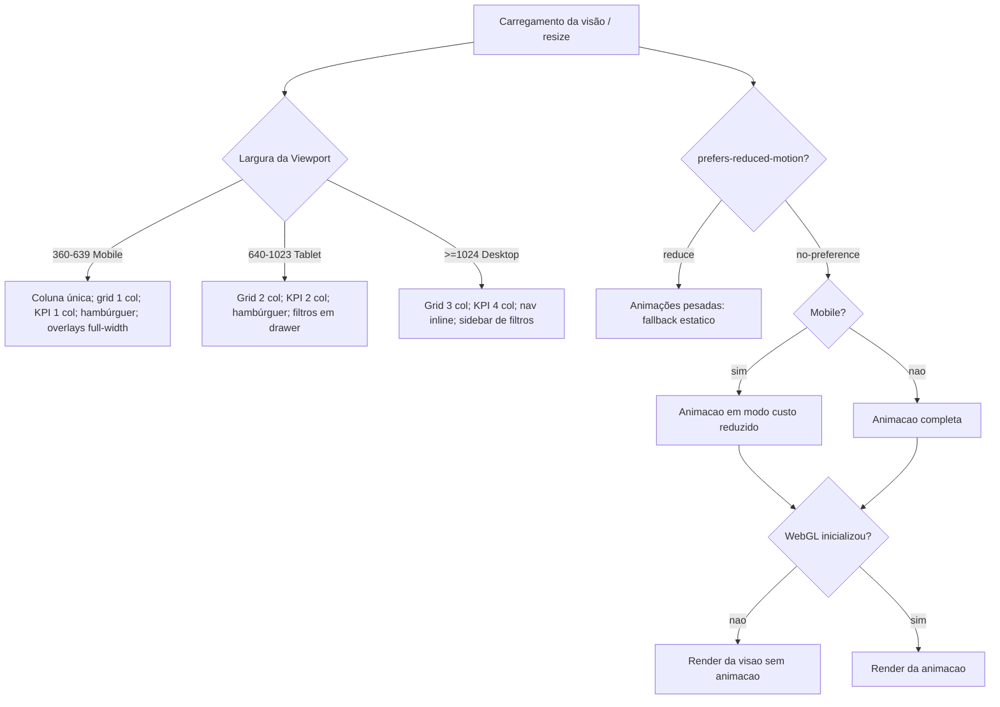

# Design Document

## Overview

Este documento descreve o design técnico para tornar todas as páginas e superfícies compartilhadas da loja **Vitta Basics** totalmente responsivas em celular, tablet e desktop, atendendo aos 12 requisitos definidos em `requirements.md`.

A aplicação é uma SPA React 19 + Vite + Tailwind CSS v4, hospedada na Vercel, com dados vindos do Supabase/TomatoPHP. As visões (`home`, `products`, `categories`, `search`, `admin`, `login-client`, `login-admin`, `signup-client`, `signup-admin`) são renderizadas condicionalmente a partir de um estado `currentTab` em `src/App.tsx` — **não há react-router**. A visão `home` renderiza componentes pesados de WebGL/canvas (`MagicRings`, `Cubes`, `ScrollVelocity`, `ScrollExpand`, `WarpText`).

A estratégia central é **padronizar o comportamento responsivo em cima dos breakpoints padrão do Tailwind já em uso no código**, em vez de introduzir um sistema novo. A maior parte da base já usa prefixos `sm:` e `lg:`; o trabalho consiste em (1) fechar as lacunas de cobertura, (2) prevenir overflow horizontal de forma global, (3) garantir alvos de toque de 44px no mobile, e (4) adicionar uma camada de detecção de viewport/movimento reduzido para degradar as animações pesadas.

### Princípios de design

- **Reaproveitar os breakpoints existentes do Tailwind.** Nenhuma reconfiguração de breakpoints. Mapeamos as faixas do glossário para os prefixos nativos (ver Arquitetura).
- **Mobile-first.** A classe base (sem prefixo) descreve o layout mobile; `sm:` e `lg:` progridem para telas maiores. É o padrão já adotado no `Product_Grid`.
- **Mudanças mínimas e localizadas por componente.** Preferir ajuste de classes utilitárias a refatorações estruturais, exceto onde a estrutura impede a responsividade (ex.: largura fixa de overlays).
- **Degradação graciosa das animações.** Reduzir custo no mobile e respeitar `prefers-reduced-motion`, com fallback seguro quando o WebGL não inicializa.
- **Verificável por viewport.** O comportamento responsivo é validado por testes Playwright em larguras fixas (360/768/1280), checando `document.body.scrollWidth`.

## Architecture

### Mapeamento de breakpoints (canônico)

Os breakpoints padrão do Tailwind v4 já usados no projeto são `sm = 640px` e `lg = 1024px`. O requisito define três faixas; mapeamos assim:

| Faixa do glossário | Largura (px CSS) | Prefixo Tailwind correspondente | Observação |
| --- | --- | --- | --- |
| `Mobile_Breakpoint` | 360–639 | base (sem prefixo), até `sm` | Pilha de coluna única |
| `Tablet_Breakpoint` | 640–1023 | `sm:` ativo, `lg:` inativo | 2 colunas no `Product_Grid` |
| `Desktop_Breakpoint` | ≥ 1024 | `lg:` ativo | 3 colunas no `Product_Grid` |
| `Supported_Width_Range` | 360–1920 | — | Faixa total validada nos testes |

Decisão de design: o limite de navegação de desktop (R5) é `lg` (1024px), que é exatamente onde o `Navbar` já alterna entre a barra inline (`hidden lg:flex`) e o hambúrguer (`lg:hidden`). Isso significa que no `Tablet_Breakpoint` (640–1023) o menu hambúrguer permanece visível, conforme R5.1.

O `Product_Grid` permanece com `grid grid-cols-1 sm:grid-cols-2 lg:grid-cols-3` (1/2/3 colunas) e os cards de KPI do admin com `grid-cols-1 sm:grid-cols-2 lg:grid-cols-4` (1/2/4 colunas), satisfazendo R2.2, R2.3, R6.1–R6.3 e R8.1 sem alteração dos valores.

### Diagrama de decisão de renderização responsiva



### Estratégia global de prevenção de overflow horizontal (R1)

Três camadas combinadas garantem `document.body.scrollWidth <= viewport width` em todas as larguras:

1. **Guarda global de overflow.** O container raiz em `App.tsx` já aplica `overflow-x-hidden` na `<div>` de nível superior. O design adiciona `overflow-x: hidden` também em `html, body` via `src/index.css`, para impedir que qualquer bloco posicionado (overlays, blur, elementos `absolute`) empurre a largura do documento. Isso é a rede de segurança para R1.1 e R1.4.
2. **Containers com largura restrita e padding consistente.** O padrão de container do projeto é `max-w-7xl mx-auto px-4 sm:px-6 lg:px-8`. O design padroniza esse padrão em todas as visões (páginas e seções da `home`) para que o conteúdo nunca encoste nas bordas e respeite a largura da Viewport (R1.2).
3. **Overflow confinado ao próprio container** para blocos intrinsecamente largos (tabelas do admin, listas de categorias, barra de abas): usar `overflow-x-auto` no wrapper do bloco em vez de deixar o bloco transbordar a página (R1.3, R8.2, R8.3). A rolagem horizontal fica dentro da caixa, e o `body` permanece sem scroll lateral.

Regra de implementação: elementos decorativos com `absolute`/`blur` (ex.: fundo do `MagicRings`, `Cubes`) devem estar sempre dentro de um ancestral `relative overflow-hidden`, nunca soltos no fluxo do documento.

### Hooks de detecção de ambiente (R2.4, R11)

Para evitar lógica duplicada de media query espalhada por componentes, o design introduz uma pequena camada de hooks reutilizáveis em `src/hooks/`:

- **`useMediaQuery(query: string): boolean`** — assina uma media query via `window.matchMedia`, com estado inicial calculado no primeiro render e listener de `change` para re-renderizar quando o breakpoint é cruzado. Serve de base para R2.4 (re-layout ao redimensionar sem recarregar; o `matchMedia` dispara em menos de 200ms).
- **`useBreakpoint(): 'mobile' | 'tablet' | 'desktop'`** — derivado de `useMediaQuery`, encapsula o mapeamento canônico (`max-width: 639px`, `(min-width:640px) and (max-width:1023px)`, `min-width: 1024px`). Usado por componentes que precisam alternar comportamento em JS (não apenas em CSS), como a degradação de animações.
- **`usePrefersReducedMotion(): boolean`** — `useMediaQuery('(prefers-reduced-motion: reduce)')`. Base para R11.2.

Decisão: layout puramente visual (grades, pilhas, visibilidade de nav) continua resolvido por classes utilitárias do Tailwind (CSS media queries nativas, mais performáticas e sem custo de re-render). Os hooks em JS são reservados para o que o CSS não resolve sozinho: gatear a montagem de componentes pesados e escolher fallbacks (R11).

### Estratégia de degradação de animações pesadas (R11)

Os `Heavy_Animation_Component` (`MagicRings`, `Cubes`, `LaserFlow`, `WavesBackground`, `ScrollVelocity`, `ScrollExpand`, `WarpText`) são tratados por um wrapper único de política, mais ajustes pontuais:

- **Wrapper `AnimationGate`** (`src/components/reactbits/AnimationGate.tsx`): componente que recebe `renderFull`, `renderReduced` e `renderStatic` (ou `children` + flags) e decide o que montar com base em `useBreakpoint()` e `usePrefersReducedMotion()`:
  - `prefers-reduced-motion: reduce` → monta o **fallback estático** (imagem/gradiente/texto sem animação contínua) — R11.2.
  - Mobile sem preferência de redução → monta o **modo de custo reduzido**: menos elementos (ex.: reduzir `ringCount` do `MagicRings`, desabilitar `followMouse`, reduzir `velocity` do `ScrollVelocity`, desabilitar `autoAnimate` do `Cubes`) ou substituir por fallback estático quando o componente não tem modo barato — R11.1.
  - Desktop sem preferência → render completo.
- **Fallback de inicialização WebGL (R11.4).** Os componentes WebGL já tratam falha de contexto retornando um `<div>` vazio (ver `MagicRings`: `try/catch` no `new THREE.WebGLRenderer` e checagem `isWebGL2`). O design formaliza isso: cada componente WebGL deve, em caso de falha, renderizar um fallback estático visível (ou nada) **sem** quebrar o layout ao redor. Como o fundo da animação fica em um ancestral `absolute inset-0` dentro de uma `section` `relative overflow-hidden`, a ausência da animação não altera a largura do documento (R11.3, R11.4).
- **Pausa fora de viewport.** `MagicRings` já usa `IntersectionObserver` + `visibilitychange` para pausar o `requestAnimationFrame`. O design recomenda o mesmo padrão nos demais componentes de canvas para reduzir custo em rolagem no mobile (reforça R11.1).

## Components and Interfaces

Cada área abaixo lista o estado atual relevante, a mudança de design e os requisitos atendidos.

### Navbar (`src/components/Navbar.tsx`) — R5

Estado atual: já implementa a barra inline `hidden lg:flex`, o hambúrguer `lg:hidden` e a sobreposição mobile `fixed inset-0 ... lg:hidden`. Verificação e ajustes:

- Manter a troca de navegação no limite `lg` (1024px): inline no `Desktop_Breakpoint`, hambúrguer no `Mobile_Breakpoint` e `Tablet_Breakpoint` (R5.1, R5.2).
- A sobreposição mobile usa `fixed inset-0` e `flex-col`, cobrindo a Viewport com os itens empilhados dentro da largura; garantir que o conteúdo não gere overflow (`px-6`, itens `w-full`) — R5.3, R5.5.
- Ao selecionar um item, `handleNavClick` já chama `onNavigate` e `setMobileMenuOpen(false)` — R5.4.
- Ajuste de toque: os botões de ícone do cabeçalho (`w-10 h-10`, `w-9 h-9`) devem atingir 44×44 de área tocável no mobile (ver seção de toque). Os itens da sobreposição já têm `p-4` (altura confortável).

### Product_Grid e Product_Card (`src/components/ProductGrid.tsx`, `src/components/pages/ProductsPage.tsx`, `src/components/ProductCardModern.tsx`) — R6

- A grade permanece `grid grid-cols-1 sm:grid-cols-2 lg:grid-cols-3` (1/2/3 colunas) tanto no `ProductGrid` quanto na `ProductsPage` — R6.1–R6.3. Nenhuma mudança de valor.
- `Product_Card` já usa `p-4 sm:p-5`, imagem `h-64 sm:h-72`, título `text-base sm:text-lg`, preço `text-xl sm:text-2xl`. O card foi recentemente corrigido para evitar overflow dos botões. Verificação:
  - Imagem e textos contidos no card (`line-clamp-1`/`line-clamp-2`) — R6.4.
  - Conjuntos de cor (`flex items-center gap-2`) e tamanho (`flex items-center gap-1.5 flex-wrap`) devem quebrar em novas linhas quando excederem a largura; o seletor de tamanho já tem `flex-wrap`. Adicionar `flex-wrap` também ao seletor de cor para cards com muitas cores — R6.5.
  - Linha de ação (`Comprar` + `Shopee`) usa `flex items-center gap-2` com botões `flex-1`; manter dentro do card sem overflow — R6.4.
- Fileira de categorias do `ProductGrid` usa `overflow-x-auto ... scrollbar-none` com `whitespace-nowrap`: a rolagem fica confinada à fileira, sem empurrar o `body` — R1.2.

### Filtros de catálogo (`src/components/pages/ProductsPage.tsx`) — R7

Estado atual: layout `grid grid-cols-1 lg:grid-cols-12`; a `aside` de filtros usa `lg:col-span-3` com classe condicional `${mobileFilterOpen ? 'block' : 'hidden lg:block'}`, e há um botão de alternância `lg:hidden` ("Filtros"). Design:

- Abaixo do `Desktop_Breakpoint` (`< lg`): a sidebar fica oculta por padrão e é revelada pelo toggle (`mobileFilterOpen`) dentro da largura da Viewport, sem overflow — R7.1, R7.2.
- No `Desktop_Breakpoint` (`lg`): a sidebar aparece ao lado da grade (`lg:col-span-3` + `lg:col-span-9`) — R7.3.
- A toolbar superior (chips de filtro ativo + ordenação) usa `flex flex-col sm:flex-row` e `flex-wrap`, mantendo chips e o `select` de ordenação dentro da largura no mobile — R7.4.
- Garantir que o painel de filtros revelado no mobile tenha largura total da coluna (`w-full`) e `space-y` vertical, sem largura fixa que estoure a tela.

### Admin_Panel (`src/components/admin/TomatoAdminPanel.tsx` e subpainéis) — R8

Estado atual já favorável: cabeçalho `flex flex-col md:flex-row`, cards de KPI `grid-cols-1 sm:grid-cols-2 lg:grid-cols-4`, barra de abas `flex ... overflow-x-auto ... scrollbar-none whitespace-nowrap`, tabelas dentro de `overflow-x-auto`. Design:

- **Cabeçalho (título + ações)**: empilhar verticalmente no `Mobile_Breakpoint`. O cabeçalho usa `flex-col md:flex-row`; como o mapeamento canônico define mobile como `< 640px`, ajustar para `flex-col sm:flex-row` para empilhar em toda a faixa mobile e já dividir a partir de tablet — R8.5.
- **Cards de KPI**: `grid-cols-1` no mobile (1 coluna), `sm:grid-cols-2` no tablet (2 colunas), `lg:grid-cols-4` no desktop (4 colunas) — R8.1.
- **Barra de abas**: `overflow-x-auto scrollbar-none` com abas `whitespace-nowrap` garante que todas as abas sejam alcançáveis rolando a barra dentro do próprio container, sem overflow da página — R8.2.
- **Data_Table**: cada tabela permanece em um wrapper `overflow-x-auto`; a tabela pode ser mais larga que a tela, mas a rolagem fica confinada ao wrapper e o layout ao redor permanece sem overflow — R8.3, R1.3. Aplicar o mesmo wrapper em `InventoryPanel`, `BulkInventoryPanel` e `CategoryAdminPanel`.
- **Modal de edição de produto (mobile)**: o modal deve caber na Viewport (`w-full max-w-*`, margens laterais) com corpo `max-h-[90vh] overflow-y-auto` para rolagem vertical do conteúdo — R8.4. Seguir o mesmo padrão do `Quick_View_Modal`.

### Overlays: Cart_Drawer, Quick_View_Modal, Search_Modal — R9

**Cart_Drawer (`src/components/CartDrawer.tsx`)** — estado atual: painel `w-screen max-w-md` ancorado à direita, com wrapper `pl-6 sm:pl-10`. Design:
- Mobile: o painel deve ocupar **largura total** da Viewport. O `w-screen` já tende a isso, mas o wrapper externo `pl-6 sm:pl-10` reduz a largura efetiva no mobile. Ajustar para remover o padding esquerdo no mobile (ex.: `pl-0 sm:pl-10`) e permitir que o painel use `w-full` até `sm`, mantendo `max-w-md` a partir de `sm` — R9.1, R9.2.
- Tablet/Desktop: largura máxima fixa de painel (`max-w-md`) ancorada à direita — R9.2.
- A lista de itens já usa `flex-1 overflow-y-auto`, com header e footer de checkout fora da área rolável, mantendo-os visíveis — R9.3.

**Quick_View_Modal (`src/components/ProductQuickViewModal.tsx`)** — estado atual: `grid grid-cols-1 md:grid-cols-12`, container `max-w-4xl max-h-[90vh] overflow-y-auto`. Design:
- Mobile: imagem e detalhes empilham em coluna única (`grid-cols-1`) e o modal cabe na Viewport (`p-4 sm:p-6`, `w-full`) — R9.4.
- Rolagem vertical do conteúdo via `max-h-[90vh] overflow-y-auto` — R9.6.
- Nota: a divisão em 12 colunas usa prefixo `md:` (768px). Como nosso tablet começa em 640px, isso significa que entre 640–767px o modal fica em coluna única — aceitável e consistente com R9.4 (empilhado no mobile) e não conflita com os demais requisitos, que só exigem empilhamento no `Mobile_Breakpoint`.

**Search_Modal (`src/components/SearchModal.tsx`)** — estado atual: `w-full max-w-2xl`, corpo `max-h-[60vh] overflow-y-auto`, padding `p-4 sm:p-6`. Design:
- Mobile: campo de busca e resultados dentro da largura (`w-full`, `px-4` no wrapper externo), sem overflow — R9.5.
- Rolagem vertical dos resultados via `max-h-[60vh] overflow-y-auto` — R9.6.
- Itens de resultado usam `flex items-center justify-between`; o rótulo "Comprar" já é `hidden sm:inline`, mantendo o botão compacto no mobile.

### Auth_Page (`ClientLoginPage`, `AdminLoginPage`, `ClientSignUpPage`, `AdminSignUpPage`) — R10

Estado atual (ex.: `ClientLoginPage`): `section` centralizada `flex min-h-screen items-center justify-center`, card `w-full max-w-md px-6`, campos via classes `login-field`/`login-input` em `src/styles/login.css`. Design:
- Card centralizado e com largura máxima que cabe na Viewport (`max-w-md` + `w-full` + `px-6`) em todas as larguras suportadas — R10.1.
- Mobile: campos e botão de envio com largura total do card (`.login-input` e `.btn-primary` em `width: 100%`) — R10.2. Verificar/ajustar o CSS para `width: 100%` nos inputs e no botão primário dentro do contexto de login.
- Mobile: altura de área tocável dos campos ≥ 44px (definir `min-height: 44px` em `.login-input` e padding vertical adequado) — R10.3.
- Mensagens de validação/erro (`.login-error`) renderizadas dentro do card, com `overflow-wrap`/`break-words` para não estourar a largura — R10.4.
- Aplicar o mesmo padrão nas quatro páginas de autenticação (elas compartilham a estrutura e o `login.css`).

### Footer (`src/components/Footer.tsx`)

Estado atual: `grid grid-cols-1 md:grid-cols-12`; coluna de navegação `grid grid-cols-2`; barra inferior `flex flex-col sm:flex-row`. Já responsivo. Verificação:
- Reduzir a logo gigante (`w-50 h-50`) para um tamanho coerente no mobile, pois um elemento muito grande pode comprometer o layout de coluna única — ajuste pontual de classe (ex.: `w-16 h-16` ou `w-20 h-20`). Contribui para R1 e R2.1.

### Home (`src/App.tsx`)

- Cada `section` da home deve ser `relative overflow-hidden` com container `max-w-* mx-auto px-4 sm:px-6 lg:px-8`, confinando os fundos animados `absolute inset-0` — R1, R11.3.
- As animações pesadas da home passam pelo `AnimationGate` (R11).
- A `ProductGrid` da home herda o comportamento 1/2/3 colunas — R6.

### Escala tipográfica (R3)

Decisão: usar os utilitários de tamanho do Tailwind já presentes, garantindo pisos mínimos no mobile:
- Texto de corpo: mínimo efetivo de 14px (`text-sm` = 0.875rem/14px) e `line-height` ≥ 1.4 (o `leading-relaxed`/`leading-normal` do Tailwind atende) — R3.1. Evitar `text-xs` (12px) para texto de leitura contínua no mobile; `text-xs` fica reservado a rótulos/metadados curtos.
- Títulos de destaque no mobile entre 20px e 40px: o H1 da home usa `text-6xl sm:text-8xl` — no mobile `text-6xl` ≈ 60px excede o teto de 40px exigido por R3.2. Ajustar os títulos de destaque para começarem dentro de 20–40px no mobile (ex.: `text-3xl`/`text-4xl` na base e escalar com `sm:`/`md:`), mantendo o scrollWidth dentro da Viewport — R3.2, R3.5.
- Quebra de texto: aplicar `break-words`/`overflow-wrap: anywhere` em containers de texto livre; usar `truncate`/`line-clamp` com reticências para tokens inquebráveis (ex.: e-mails longos em tabelas) — R3.3, R3.4.

### Alvos de toque (R4)

- **Mínimo 44×44.** Botões de ícone pequenos (`w-9 h-9` = 36px, `w-10 h-10` = 40px) ficam abaixo de 44px. Estratégia: no mobile, elevar a área tocável para ≥ 44px sem necessariamente aumentar o ícone visual, usando padding/`min-w`/`min-h` ou uma área de toque expandida. Padrão recomendado: classe utilitária compartilhada (ex.: `tap-target` em `index.css` com `min-width:44px; min-height:44px`) aplicada aos controles de ícone no mobile — R4.1, R4.4.
  - Observação: o `.btn-icon` em `index.css` já tem `44px` × `44px` — usá-lo como referência de tamanho.
- **Espaçamento ≥ 8px** entre alvos adjacentes no mobile: usar `gap-2` (8px) ou maior nas fileiras de controles adjacentes; auditar `gap-1`/`gap-1.5` (4–6px) em controles interativos adjacentes no mobile e elevar para `gap-2` — R4.2.
- **Controles de ação principal alcançáveis** dentro da área rolável (adicionar ao carrinho, finalizar compra, enviar, navegar): nenhum CTA principal pode ficar preso fora da viewport ou atrás de overflow; manter dentro do fluxo rolável das visões/overlays — R4.3.
- **Ativação única.** O espaçamento mínimo e o tamanho de 44px, combinados, reduzem toques errados; `e.stopPropagation()` já é usado nos controles aninhados do card para evitar ativação de alvos sobrepostos — R4.5.

### Meta viewport (R12)

- O `index.html` já declara `<meta name="viewport" content="width=device-width, initial-scale=1.0" />` — R12.1 já satisfeito. O design apenas **verifica** essa tag e garante que ela não seja removida; nenhum trabalho de implementação é necessário além da verificação.
- Com `overflow-x-hidden` global e containers restritos, a visão inicial é dimensionada à largura do dispositivo sem exigir zoom-out — R12.2.

## Data Models

Este recurso é de apresentação/layout e **não introduz novos modelos de dados persistidos**. As únicas estruturas novas são tipos de apoio em TypeScript para os hooks de ambiente:

```ts
// src/hooks/useBreakpoint.ts
export type Breakpoint = 'mobile' | 'tablet' | 'desktop';

// Faixas canônicas (px CSS) — espelham o glossário e os breakpoints do Tailwind
export const BREAKPOINTS = {
  mobileMax: 639,   // Mobile_Breakpoint: 360-639
  tabletMin: 640,   // Tablet_Breakpoint: 640-1023 (sm)
  desktopMin: 1024, // Desktop_Breakpoint: >= 1024 (lg)
} as const;

export function useMediaQuery(query: string): boolean;
export function useBreakpoint(): Breakpoint;
export function usePrefersReducedMotion(): boolean;
```

```ts
// src/components/reactbits/AnimationGate.tsx
export interface AnimationGateProps {
  /** Render completo (desktop, sem preferencia de reducao) */
  renderFull: () => React.ReactNode;
  /** Modo de custo reduzido (mobile) — opcional; se ausente, usa renderStatic */
  renderReduced?: () => React.ReactNode;
  /** Fallback estatico (prefers-reduced-motion ou falha de WebGL) */
  renderStatic: () => React.ReactNode;
}
```

Nenhuma mudança em `src/types/ecommerce.ts`, `src/types/inventory.ts` ou nos serviços (`tomatoApi`, `inventoryService`).

## Error Handling

- **Falha de inicialização WebGL/canvas (R11.4).** Cada `Heavy_Animation_Component` deve envolver a criação do contexto em `try/catch` (padrão já presente em `MagicRings`) e, em falha ou ausência de WebGL2, renderizar o fallback estático via `AnimationGate` sem lançar erro para a árvore. O `ErrorBoundary` existente (`src/components/ErrorBoundary.tsx`) deve envolver as seções de animação da home como rede de segurança adicional, exibindo a visão ao redor sem a animação e sem overflow.
- **`matchMedia` indisponível (SSR/ambientes antigos).** Os hooks devem checar `typeof window !== 'undefined'` e `window.matchMedia` antes de assinar, retornando um padrão seguro (ex.: `desktop` / `false`) quando indisponível. Isso evita que a ausência de API quebre a montagem.
- **Resolução de layout indefinida (R2.5).** Como o layout é resolvido por CSS media queries nativas (sempre determinísticas), não há estado "sem layout". Caso um hook JS falhe ao resolver o breakpoint, ele mantém o último valor conhecido (estado React preservado) e o CSS continua aplicando o último layout correspondente — as regiões de conteúdo permanecem visíveis, nunca colapsadas/vazias — R2.5.
- **Conteúdo mais largo que a Viewport.** Blocos largos (tabelas, fileiras de chips) nunca transbordam o `body`; são confinados por `overflow-x-auto` no wrapper. Se um token inquebrável aparecer, `truncate`/`break-words` evita o estouro — R1.2, R3.3, R3.4.

## Testing Strategy

### Avaliação sobre Property-Based Testing

Este recurso trata de **renderização e layout de UI responsiva**. Conforme a orientação de quando o PBT **não** é apropriado (renderização de UI e layout devem usar testes de snapshot/regressão visual e testes por exemplo), **não há seção de Correctness Properties neste design** e não se adota uma biblioteca de PBT com geradores. Em vez disso, a verificação é feita por **testes de viewport parametrizados** no Playwright, que exercem as mesmas invariantes "para todas as larguras" de forma determinística e barata, mais testes por exemplo para interações específicas.

A ferramenta de teste já existe no projeto: Playwright configurado em `playwright.config.ts` (com projetos Desktop e Mobile: `Pixel 5`, `iPhone 12`) e a suíte `e2e/store-flow.spec.ts`.

### Testes de viewport (Playwright) — invariantes responsivas

Criar `e2e/responsive.spec.ts` parametrizado nas três larguras canônicas: **360** (Mobile), **768** (Tablet), **1280** (Desktop). Para cada visão (`home`, `products`, `categories`, `search`, `admin`, e uma `Auth_Page`):

- **Sem overflow horizontal (R1).** Após carregar e estabilizar, afirmar:
  ```ts
  const scrollW = await page.evaluate(() => document.body.scrollWidth);
  const vw = await page.evaluate(() => window.innerWidth);
  expect(scrollW).toBeLessThanOrEqual(vw);
  ```
  Repetir para 360, 768, 1280 e para a largura mínima exata de 360px (R1.4). Verificar também que o `document.body` não rola horizontalmente (`scrollWidth <= clientWidth`).
- **Colunas por breakpoint (R2.2, R2.3, R6.1–R6.3, R8.1).** Em `products`/home, contar os cards por linha comparando `getBoundingClientRect().top` dos `Product_Card` (mesma linha = mesmo `top`): 1 em 360, 2 em 768, 3 em 1280. Para KPI do admin: 1/2/4.
- **Navbar (R5).** Em 360/768: hambúrguer visível e barra inline oculta; ao abrir, os itens ficam dentro da largura e a seleção navega e fecha a sobreposição. Em 1280: barra inline visível e hambúrguer oculto.
- **Filtros (R7).** Em 360/768: sidebar oculta e toggle presente; ao ativar, o painel aparece sem overflow. Em 1280: sidebar visível ao lado da grade.
- **Admin tabela/abas (R8.2, R8.3).** Verificar que o wrapper da `Data_Table` tem `overflow-x` rolável enquanto o `body` permanece sem scroll lateral; verificar que a barra de abas rola horizontalmente dentro do próprio container.
- **Overlays (R9).** Em 360: `Cart_Drawer` ocupa a largura total; abrir `Quick_View_Modal` e `Search_Modal` e afirmar ausência de overflow e presença de rolagem vertical quando o conteúdo excede a altura.
- **Alvos de toque (R4).** Para controles interativos-chave no mobile, medir `getBoundingClientRect()` e afirmar `width >= 44 && height >= 44`.
- **Tipografia (R3).** Ler `getComputedStyle` do texto de corpo e afirmar `fontSize >= 14px` e `lineHeight >= 1.4 * fontSize`; para títulos de destaque no mobile, `20px <= fontSize <= 40px`.
- **Meta viewport (R12).** Afirmar que a tag `meta[name="viewport"]` existe com `width=device-width` e `initial-scale=1`.

### Testes de movimento reduzido e WebGL (R11)

- **Movimento reduzido.** Usar `test.use({ reducedMotion: 'reduce' })` do Playwright e afirmar que, nas seções de animação, o fallback estático é renderizado (ausência do `<canvas>` ativo / presença do elemento de fallback) e que a visão permanece sem overflow — R11.2, R11.3.
- **Custo reduzido no mobile.** Nos projetos mobile, afirmar que a animação monta em modo reduzido (ex.: canvas ausente ou parâmetros reduzidos), sem overflow — R11.1.
- **Falha de WebGL.** Simular contexto indisponível (ex.: injetar um `WebGLRenderingContext` nulo via `addInitScript`) e afirmar que a visão renderiza sem a animação e sem overflow — R11.4. Como alternativa de unidade, testar o `AnimationGate`/`ErrorBoundary` isoladamente.

### Testes unitários (Vitest/RTL) — exemplos e casos de borda

- `useMediaQuery` / `useBreakpoint`: montar com `matchMedia` mockado em diferentes larguras e afirmar o breakpoint resolvido; simular `change` e afirmar re-render (apoia R2.4).
- `usePrefersReducedMotion`: mock de `(prefers-reduced-motion: reduce)` → `true/false`.
- `AnimationGate`: dado cada combinação (desktop/mobile × reduce/no-preference × webgl ok/falha), afirmar qual branch é renderizado (full/reduced/static).
- Casos de borda: `matchMedia` indisponível → padrão seguro; token inquebrável em texto → classe de truncamento aplicada.

### Abordagem dupla (unidade + viewport)

Testes unitários cobrem a lógica dos hooks e do gate (exemplos e bordas). Os testes de viewport Playwright cobrem o comportamento de layout de ponta a ponta nas larguras suportadas, funcionando como verificação determinística das invariantes "para todas as larguras suportadas" exigidas por R1–R12.

## Requirements Traceability

| Requisito | Seções de design que o atendem |
| --- | --- |
| R1 — Sem overflow horizontal | Architecture › Estratégia global de prevenção de overflow; Error Handling; Product_Grid (fileira de categorias); Admin (tabelas); Testing (viewport R1) |
| R2 — Layout responsivo por breakpoint | Architecture › Mapeamento de breakpoints, Diagrama; Hooks (`useMediaQuery` para R2.4); Error Handling (R2.5); Testing (colunas) |
| R3 — Tipografia legível | Components › Escala tipográfica; Error Handling (quebra/truncamento); Testing (tipografia) |
| R4 — Alvos de toque | Components › Alvos de toque; Navbar; Testing (toque) |
| R5 — Navegação responsiva | Components › Navbar; Testing (navbar) |
| R6 — Grade e cards de produto | Components › Product_Grid e Product_Card; Testing (colunas) |
| R7 — Filtros de catálogo | Components › Filtros de catálogo; Testing (filtros) |
| R8 — Painel administrativo | Components › Admin_Panel; Architecture › overflow confinado; Testing (admin) |
| R9 — Overlays (carrinho/quickview/busca) | Components › Overlays; Testing (overlays) |
| R10 — Formulários de autenticação | Components › Auth_Page; Testing (viewport Auth) |
| R11 — Animações conscientes de desempenho | Architecture › Degradação de animações, Hooks; Error Handling (WebGL); Data Models (`AnimationGate`); Testing (movimento reduzido/WebGL) |
| R12 — Meta viewport | Components › Meta viewport; Testing (meta viewport) |
